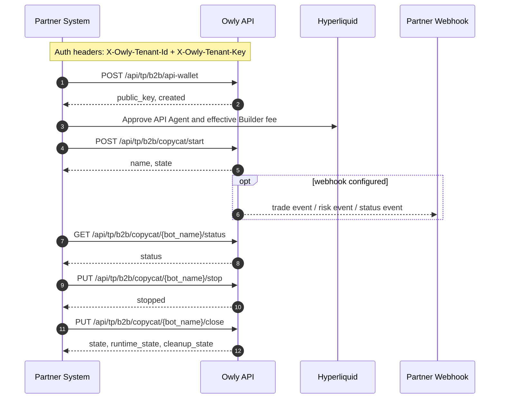

Esta guía está dirigida a socios comerciales que integran Owly a nivel de inquilino. Explica cómo crear una billetera API para una dirección de destino, iniciar una instancia de estrategia, recibir eventos de webhook y administrar el ciclo de vida de la estrategia a través del API externo de Owly.

<Note>
Todos los puntos finales B2B se autentican con credenciales de inquilino. Si busca una configuración estándar de producto para el usuario final, comience desde [Conceptos básicos](/es/guide/concepts) y [Inicio rápido](/es/guide/quick-start).
</Note>

## Flujo de integración

El orden recomendado es:

1. Cree o recupere una billetera API para la dirección de destino.
2. Aprobar el `public_key` devuelto como Agente Hyperliquid API y completar la autorización efectiva de comisión Builder.
3. Opcionalmente, ejecute `source-check` antes del copy trading, luego inicie la instancia de estrategia Owly.
4. Guarde el identificador del bot devuelto para llamadas de estado y ciclo de vida posteriores.
5. Reciba notificaciones de webhook si está configurado.



## URL base

| Medio ambiente | URL |
| --- | --- |
| Producción | `https://app.owly.fi` |
| Desarrollo | `https://dev-app.owly.fi` |

## Autenticación

Cada solicitud debe incluir estos encabezados:

```http
X-Owly-Tenant-Id: <tenant_id>
X-Owly-Tenant-Key: <tenant_key>
Content-Type: application/json
```

| Encabezado | Requerido | Descripción |
| --- | --- | --- |
| `X-Owly-Tenant-Id` | Sí | Identificador de inquilino emitido por Owly |
| `X-Owly-Tenant-Key` | Sí | Secreto del inquilino emitido por Owly |
| `Content-Type` | Para solicitudes JSON | `application/json`; Las solicitudes GET no necesitan un cuerpo |

## Formato de respuesta

Las respuestas exitosas siguen este sobre:

```json
{
  "code": 0,
  "msg": "success",
  "timestamp": 1763471388,
  "data": {}
}
```

El error `detail` puede ser una cadena, un objeto que contiene campos como `code` / `message` o una lista de errores de validación. Los errores de inicio también pueden devolver un `bot_name` de nivel superior para consultas de seguimiento. No coincida solo con un mensaje de error fijo en inglés. Por ejemplo, las cuentas propiedad del protocolo no se pueden agregar a través del flujo de billetera B2B genérica:

```json
{
  "detail": {
    "code": "leveracc_dedicated_flow_required"
  }
}
```

Códigos de estado HTTP comunes:

| Estado | Significado |
| --- | --- |
| `400` | Parámetros de solicitud no válidos |
| `401` | Error en la autenticación del inquilino |
| `403` | La cuenta de inquilino o de destino no está disponible |
| `404` | Recurso no encontrado |
| `409` | Conflicto de estado de recursos |
| `422` | Error en la validación del cuerpo o del campo |
| `500` | Error interno de servicio o ejecución |
| `503` | La dependencia de verificación de autorización o cuenta no está disponible |

## Paso 1: Crear o recuperar una billetera API

### Punto final

```http
POST /api/tp/b2b/api-wallet
```

### Cuerpo de solicitud

```json
{
  "target": "0x1111111111111111111111111111111111111111"
}
```

| Campo | Tipo | Requerido | Descripción |
| --- | --- | --- | --- |
| `target` | cadena | Sí | Dirección EVM que ejecutará la estrategia |
| `created` | booleano | No | El valor predeterminado es `false` para reutilizar una billetera existente; `true` solicita un reemplazo |
| `idempotency_key` | cadena | Cuando `created=true` | 1–128 caracteres; reutilizar el mismo valor al volver a intentar una rotación |

### Ejemplo de éxito

```json
{
  "code": 0,
  "msg": "success",
  "timestamp": 1763471388,
  "data": {
    "tenant_id": "tenant-demo",
    "target": "0x1111111111111111111111111111111111111111",
    "public_key": "0xaaaaaaaaaaaaaaaaaaaaaaaaaaaaaaaaaaaaaaaa",
    "created": true
  }
}
```

| Campo | Tipo | Descripción |
| --- | --- | --- |
| `tenant_id` | cadena | ID de inquilino actual |
| `target` | cadena | Dirección de destino solicitada |
| `public_key` | cadena | API clave pública de billetera que debe configurarse como el Agente Hyperliquid API |
| `created` | booleano | `true` si la billetera se creó ahora; `false` si se devolvió una billetera existente |

<Tip>
Owly almacena de forma segura la clave privada de la billetera API y no la devuelve al socio.
</Tip>

El objetivo debe utilizar actualmente el modo `unifiedAccount` o `dexAbstraction`. Las solicitudes fallan si no se puede verificar el modo. Este punto final no cambia el modo de cuenta de destino.

Comportamiento importante:

- Repetir la misma solicitud para el mismo `target` bajo el mismo inquilino devuelve la billetera existente siempre que sea posible.
- Si el `target` ya está ocupado por otro inquilino u otro flujo incompatible, el API devuelve `409`.
- Después de la rotación, apruebe nuevamente el `public_key` devuelto y verifique el estado de la estrategia. Generar un reemplazo no completa la autorización Hyperliquid.
- Reintentar `created=true` con la misma clave de idempotencia devuelve la billetera de esa rotación. La respuesta `created` informa si esta llamada creó una billetera; su significado difiere del indicador de solicitud.

Ejemplo de solicitud de rotación:

```json
{
  "target": "0x1111111111111111111111111111111111111111",
  "created": true,
  "idempotency_key": "wallet-rotation-001"
}
```

## Paso 2: Configure el agente API en Hyperliquid

Utilice el `public_key` devuelto en el paso 1 y configúrelo como el Agente API para la dirección de destino en Hyperliquid.

El socio completa estas autorizaciones el Hyperliquid. Aprobar la dirección efectiva del Builder y la tarifa, así como el Agente API: la startup verifica ambos. La configuración del Builder puede provenir de la cuenta, una estrategia existente o la configuración del inquilino, así que confirme la configuración de integración en lugar de asumir que se aplica una tarifa a cada inquilino.

## Verifique las fuentes de copy-trading

```http
POST /api/tp/b2b/copycat/source-check
```

Utilice los mismos encabezados de inquilinos y envíe direcciones 1–20 EVM:

```json
{
  "sources": ["0x2222222222222222222222222222222222222222"]
}
```

Ejemplo de éxito `data`:

```json
{
  "results": [
    {
      "address": "0x2222222222222222222222222222222222222222",
      "eligible": true,
      "account_mode": "unifiedAccount",
      "rejection_reason": null,
      "order_risk_metrics": null
    }
  ]
}
```

Esta verificación requiere que las fuentes utilicen `unifiedAccount` y verifica los pedidos históricos cuando las verificaciones de riesgo de comportamiento de los pedidos están habilitadas. Los motivos de rechazo incluyen `account_mode_not_unified`, `high_risk_order_behavior` o datos de verificación no disponibles. Las métricas de riesgo pueden ser nulas. Este resultado no otorga autorización ni garantía de ejecución; El inicio realiza su propia validación.

## Paso 3: Iniciar la instancia de estrategia

### Punto final

```http
POST /api/tp/b2b/copycat/start
```

### Cuerpo de solicitud

```json
{
  "config": {
    "bot_type": "copytrading",
    "target": "0x1111111111111111111111111111111111111111",
    "source": "0x2222222222222222222222222222222222222222",
    "copy_ratio": 1.0,
    "included_coins": [],
    "excluded_coins": [],
    "included_dexs": [""],
    "alerts": {
      "enable": true,
      "webhook": "https://partner.example.com/owly/callback"
    }
  }
}
```

| Campo | Tipo | Requerido | Descripción |
| --- | --- | --- | --- |
| `config` | objeto configuración | Sí | `copytrading` o `grid`; los puntos finales públicos solo admiten objetivos Hyperliquid |
| `config.alerts` | objeto configuración | No | Configuración de notificaciones; el ejemplo habilita explícitamente alertas y proporciona un webhook |
| `config.alerts.webhook` | cadena \| nulo | No | Campo de devolución de llamada preferido; explícito `null` lo borra |
| `webhook` | cadena \| nulo | No | Campo de compatibilidad de nivel superior obsoleto; migrar a `config.alerts.webhook` |

El copia de operaciones ordinario requiere `source`; Los robots de grid requieren una configuración `grid` válida. Las cuadrículas perpetuas requieren `grid.total_invest` positivo, del cual el servidor deriva el tamaño del pedido. Consulte [Grid Bot](/es/guide/grid-bot). No envíe claves privadas de billetera maestra o de billetera API.

### Precedencia de webhook

| Solicitar forma | Comportamiento |
| --- | --- |
| Explícito `config.alerts.webhook` | Anula el campo de nivel superior y el valor predeterminado del inquilino; explícito `null` lo borra |
| Campo anidado omitido, nivel superior `webhook` proporcionado | Utilice el campo de compatibilidad; explícito `null` lo borra |
| Ambos campos se omiten, el valor predeterminado del inquilino existe | Usar el inquilino predeterminado |
| Ambos campos se omiten, no hay inquilino predeterminado | Preservar el webhook del bot existente |

`config.alerts=null` por sí solo no establece explícitamente `config.alerts.webhook=null`. La entrega también depende del cambio de notificación y de la configuración del evento.

### Ejemplo de éxito

```json
{
  "code": 0,
  "msg": "success",
  "timestamp": 1763471390,
  "data": {
    "name": "bot_abc123",
    "state": "running",
    "runtime_state": "active",
    "cleanup_state": "none",
    "start_time": null,
    "uptime": null,
    "err_msg": null
  }
}
```

<Note>
El campo `name` en la respuesta es el `bot_name` utilizado por los puntos finales de estado, parada y cierre. Persiste de tu lado.
</Note>

## Notificaciones de webhook

Con las notificaciones habilitadas y un webhook válido configurado, Owly puede entregar las notificaciones de estrategia configuradas a su punto final de devolución de llamada.

Las categorías de webhooks incluyen:

- `trade event`: eventos relacionados con el comercio producidos por la instancia de estrategia
- `risk event`: eventos de control de riesgos producidos por la instancia de estrategia
- `status event`: cambios de estado de estrategia

Expectativas de manejo del webhook:

- devuelve `2xx` para acusar recibo exitosamente
- diseñar el receptor para que sea idempotente
- asume que es posible realizar reintentos y entregas duplicadas
- se basa únicamente en los campos de eventos externos y la semántica empresarial de Owly, no en los nombres de servicios internos ni en las máquinas de estado internas

## Puntos finales del ciclo de vida de la estrategia

### Obtener estado

```http
GET /api/tp/b2b/copycat/{bot_name}/status
```

Ejemplo de éxito:

```json
{
  "code": 0,
  "msg": "success",
  "timestamp": 1763471391,
  "data": {
    "name": "bot_abc123",
    "state": "running",
    "runtime_state": "active",
    "cleanup_state": "none",
    "start_time": null,
    "uptime": null,
    "err_msg": null
  }
}
```

`data` utiliza la estructura de estado de estrategia. Las llamadas de inicio, parada y cierre exitosas también devuelven esta estructura:

| Campo | Significado |
| --- | --- |
| `name` | El `bot_name` para solicitudes posteriores |
| `state` | Estado del ciclo de vida, como `running`, `stopped`, `terminated` o `error` |
| `runtime_state` | Estado de ejecución, como `active`, `idle`, `degraded`, `risk_exit_in_progress` o `risk_exit_failed` |
| `cleanup_state` | `none`, `in_progress`, `completed` o `failed` |
| `start_time` / `uptime` | Hora de inicio y segundos transcurridos; puede ser nulo |
| `err_msg` | Información de error opcional |

Verifique el estado de ejecución, el estado de limpieza y los errores juntos. `state=running` por sí solo no prueba que la estrategia sea realizar pedidos con normalidad.

### Detener una estrategia

```http
PUT /api/tp/b2b/copycat/{bot_name}/stop
```

`stop` detiene la ejecución automatizada sin ejecutar la limpieza de cierre de posición. Verifique las posiciones y pedidos existentes por separado. Ejemplo de estado detenido:

```json
{
  "code": 0,
  "msg": "success",
  "timestamp": 1763471392,
  "data": {
    "name": "bot_abc123",
    "state": "stopped",
    "runtime_state": "stopped",
    "cleanup_state": "none",
    "start_time": null,
    "uptime": null,
    "err_msg": null
  }
}
```

### Cerrar una estrategia

```http
PUT /api/tp/b2b/copycat/{bot_name}/close
```

`close` solicita la terminación de la estrategia y su limpieza, incluidos los intentos de cerrar posiciones y borrar órdenes relacionadas. No retira fondos ni reembolsa préstamos. Verifique `cleanup_state` y `err_msg`, y verifique las posiciones y pedidos reales. Después de un tiempo de espera o un error de limpieza, consulte el estado actual antes de decidir qué hacer a continuación.

Este ejemplo muestra la forma de respuesta después de completar la limpieza; no garantiza que cada solicitud de cierre complete la limpieza:

```json
{
  "code": 0,
  "msg": "success",
  "timestamp": 1763471393,
  "data": {
    "name": "bot_abc123",
    "state": "terminated",
    "runtime_state": "terminated",
    "cleanup_state": "completed",
    "start_time": null,
    "uptime": null,
    "err_msg": null
  }
}
```

## Errores comunes

| Estado | Situación | Qué comprobar |
| --- | --- | --- |
| `400` | Modo de destino no compatible o autorización incompleta de agente API y Builder | Modo cuenta y autorizaciones efectivas |
| `401` | Credenciales de inquilino no válidas | Ambos encabezados de inquilinos |
| `403` | Inquilino inactivo o cuenta no disponible | Estado de cuenta e inquilino |
| `404` | No se encontró la cuenta de destino o el bot | Propiedad del inquilino y `bot_name` |
| `409` | Conflicto de propiedad, operación simultánea del ciclo de vida o estado incompatible | Consultar estado antes de resolver el conflicto |
| `422` | Dirección, clave de idempotencia o configuración no válida | Esquema de solicitud actual |
| `500` / `503` | Fallo de ejecución o dependencia de verificación no disponible | Conservar `bot_name` y detalles del error; consultar el estado actual |

Los errores pueden contener cadenas o códigos comerciales estructurados. Un tiempo de espera no prueba que el inicio nunca haya ocurrido: consulte el `bot_name` conocido antes de repetir una operación.

## Ejemplo de rizo mínimo

### Crear una billetera API

```bash
curl -X POST "https://dev-app.owly.fi/api/tp/b2b/api-wallet" \
  -H "Content-Type: application/json" \
  -H "X-Owly-Tenant-Id: tenant-demo" \
  -H "X-Owly-Tenant-Key: tenant-secret" \
  -d '{
    "target": "0x1111111111111111111111111111111111111111"
  }'
```

### Iniciar una estrategia

```bash
curl -X POST "https://dev-app.owly.fi/api/tp/b2b/copycat/start" \
  -H "Content-Type: application/json" \
  -H "X-Owly-Tenant-Id: tenant-demo" \
  -H "X-Owly-Tenant-Key: tenant-secret" \
  -d '{
    "config": {
      "bot_type": "copytrading",
      "target": "0x1111111111111111111111111111111111111111",
      "source": "0x2222222222222222222222222222222222222222",
      "copy_ratio": 1.0,
      "included_coins": [],
      "excluded_coins": [],
      "included_dexs": [""],
      "alerts": {
        "enable": true,
        "webhook": "https://partner.example.com/owly/callback"
      }
    }
  }'
```

### Estado de la consulta

```bash
curl -X GET "https://dev-app.owly.fi/api/tp/b2b/copycat/bot_abc123/status" \
  -H "X-Owly-Tenant-Id: tenant-demo" \
  -H "X-Owly-Tenant-Key: tenant-secret"
```

## Recomendaciones de integración

- Siga a `api-wallet -> Hyperliquid Agent + Builder approval -> optional source-check -> start`.
- Persiste el `bot_name` devuelto inmediatamente.
- Hacer que los consumidores de webhooks sean idempotentes y seguros para los reintentos.
- Trate los eventos de webhook como notificaciones comerciales Owly y no dependa de los detalles de implementación interna de Owly.
- Reutilizar carteras API de forma predeterminada. Solicite la rotación con `created=true` y reutilice la clave de idempotencia para reintentar esa rotación.
- Si el inicio falla, verifique las credenciales del tenant, el modo de cuenta, las aprobaciones del agente y el Builder, la propiedad del objetivo y la configuración de la estrategia; Inspeccione también el tiempo de ejecución y el estado de limpieza.
