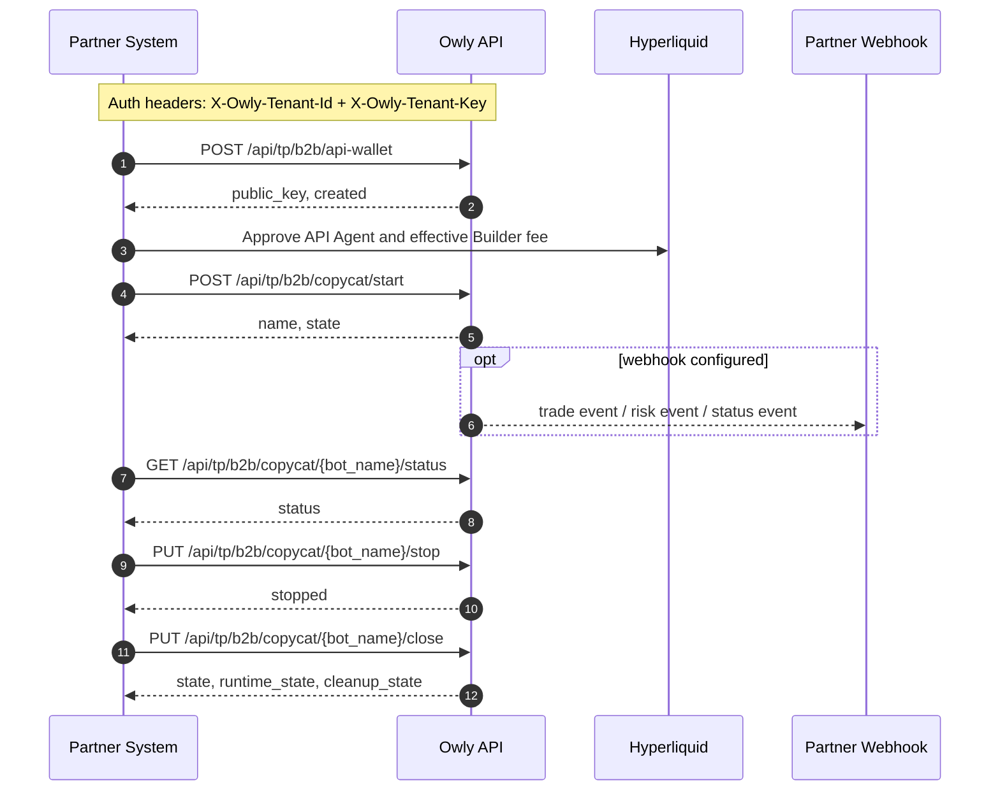

This guide is for business partners integrating Owly at the tenant level. It explains how to create an API wallet for a target address, start a strategy instance, receive webhook events, and manage the strategy lifecycle through Owly's external API.

<Note>
All B2B endpoints are authenticated with tenant credentials. If you are looking for standard end-user product setup, start from [Core Concepts](/guide/concepts) and [Quick Start](/guide/quick-start).
</Note>

## Integration Flow

The recommended order is:

1. Create or fetch an API wallet for the target address.
2. Approve the returned `public_key` as the Hyperliquid API Agent and complete the effective Builder fee authorization.
3. Optionally run `source-check` before copy trading, then start the Owly strategy instance.
4. Save the returned bot identifier for later status and lifecycle calls.
5. Receive webhook notifications if configured.



## Base URL

| Environment | URL |
| --- | --- |
| Production | `https://app.owly.fi` |
| Development | `https://dev-app.owly.fi` |

## Authentication

Every request must include these headers:

```http
X-Owly-Tenant-Id: <tenant_id>
X-Owly-Tenant-Key: <tenant_key>
Content-Type: application/json
```

| Header | Required | Description |
| --- | --- | --- |
| `X-Owly-Tenant-Id` | Yes | Tenant identifier issued by Owly |
| `X-Owly-Tenant-Key` | Yes | Tenant secret issued by Owly |
| `Content-Type` | For JSON requests | `application/json`; GET requests do not need a body |

## Response Format

Successful responses follow this envelope:

```json
{
  "code": 0,
  "msg": "success",
  "timestamp": 1763471388,
  "data": {}
}
```

Error `detail` can be a string, an object containing fields such as `code` / `message`, or a validation-error list. Start failures may also return a top-level `bot_name` for follow-up queries. Do not match only a fixed English error message. For example, protocol-owned accounts cannot be added through the generic B2B wallet flow:

```json
{
  "detail": {
    "code": "leveracc_dedicated_flow_required"
  }
}
```

Common HTTP status codes:

| Status | Meaning |
| --- | --- |
| `400` | Invalid request parameters |
| `401` | Tenant authentication failed |
| `403` | Tenant or target account is unavailable |
| `404` | Resource not found |
| `409` | Resource state conflict |
| `422` | Body or field validation failed |
| `500` | Internal service or execution error |
| `503` | Account or authorization verification dependency is unavailable |

## Step 1: Create or Fetch an API Wallet

### Endpoint

```http
POST /api/tp/b2b/api-wallet
```

### Request Body

```json
{
  "target": "0x1111111111111111111111111111111111111111"
}
```

| Field | Type | Required | Description |
| --- | --- | --- | --- |
| `target` | string | Yes | EVM address that will run the strategy |
| `created` | boolean | No | Defaults to `false` to reuse an existing wallet; `true` requests a replacement |
| `idempotency_key` | string | When `created=true` | 1–128 characters; reuse the same value when retrying one rotation |

### Success Example

```json
{
  "code": 0,
  "msg": "success",
  "timestamp": 1763471388,
  "data": {
    "tenant_id": "tenant-demo",
    "target": "0x1111111111111111111111111111111111111111",
    "public_key": "0xaaaaaaaaaaaaaaaaaaaaaaaaaaaaaaaaaaaaaaaa",
    "created": true
  }
}
```

| Field | Type | Description |
| --- | --- | --- |
| `tenant_id` | string | Current tenant ID |
| `target` | string | Requested target address |
| `public_key` | string | API wallet public key that must be set as the Hyperliquid API Agent |
| `created` | boolean | `true` if the wallet was created now; `false` if an existing wallet was returned |

<Tip>
Owly securely stores the API wallet private key and does not return it to the partner.
</Tip>

The target must currently use `unifiedAccount` or `dexAbstraction` mode. Requests fail if the mode cannot be verified. This endpoint does not switch the target account mode.

Important behavior:

- Repeating the same request for the same `target` under the same tenant returns the existing wallet whenever possible.
- If the `target` is already occupied by another tenant or another incompatible flow, the API returns `409`.
- After rotation, approve the returned `public_key` again and check the strategy status. Generating a replacement does not complete Hyperliquid authorization.
- Retrying `created=true` with the same idempotency key returns the wallet from that rotation. Response `created` reports whether this call created a wallet; its meaning differs from the request flag.

Rotation request example:

```json
{
  "target": "0x1111111111111111111111111111111111111111",
  "created": true,
  "idempotency_key": "wallet-rotation-001"
}
```

## Step 2: Set the API Agent on Hyperliquid

Use the `public_key` returned in Step 1 and set it as the API Agent for the target address on Hyperliquid.

The partner completes these authorizations on Hyperliquid. Approve the effective Builder address and fee as well as the API Agent: startup verifies both. Builder settings may come from the account, an existing strategy, or tenant configuration, so confirm the integration settings instead of assuming one fee applies to every tenant.

## Check Copy-Trading Sources

```http
POST /api/tp/b2b/copycat/source-check
```

Use the same tenant headers and submit 1–20 EVM addresses:

```json
{
  "sources": ["0x2222222222222222222222222222222222222222"]
}
```

Example success `data`:

```json
{
  "results": [
    {
      "address": "0x2222222222222222222222222222222222222222",
      "eligible": true,
      "account_mode": "unifiedAccount",
      "rejection_reason": null,
      "order_risk_metrics": null
    }
  ]
}
```

This check requires sources to use `unifiedAccount` and checks historical orders when order-behavior risk checks are enabled. Rejection reasons include `account_mode_not_unified`, `high_risk_order_behavior`, or unavailable verification data. Risk metrics may be null. This result grants no authorization or execution guarantee; startup performs its own validation.

## Step 3: Start the Strategy Instance

### Endpoint

```http
POST /api/tp/b2b/copycat/start
```

### Request Body

```json
{
  "config": {
    "bot_type": "copytrading",
    "target": "0x1111111111111111111111111111111111111111",
    "source": "0x2222222222222222222222222222222222222222",
    "copy_ratio": 1.0,
    "included_coins": [],
    "excluded_coins": [],
    "included_dexs": [""],
    "alerts": {
      "enable": true,
      "webhook": "https://partner.example.com/owly/callback"
    }
  }
}
```

| Field | Type | Required | Description |
| --- | --- | --- | --- |
| `config` | object | Yes | `copytrading` or `grid` configuration; public endpoints support Hyperliquid targets only |
| `config.alerts` | object | No | Notification settings; the example explicitly enables alerts and supplies a webhook |
| `config.alerts.webhook` | string \| null | No | Preferred callback field; explicit `null` clears it |
| `webhook` | string \| null | No | Deprecated top-level compatibility field; migrate to `config.alerts.webhook` |

Ordinary copy trading requires `source`; grid bots require a valid `grid` configuration. Perpetual grids require positive `grid.total_invest`, from which the server derives order size. See [Grid Bot](/guide/grid-bot). Do not submit master-wallet or API-wallet private keys.

### Webhook Precedence

| Request shape | Behavior |
| --- | --- |
| Explicit `config.alerts.webhook` | Overrides the top-level field and tenant default; explicit `null` clears it |
| Nested field omitted, top-level `webhook` supplied | Use the compatibility field; explicit `null` clears it |
| Both fields omitted, tenant default exists | Use the tenant default |
| Both fields omitted, no tenant default | Preserve the existing bot webhook |

`config.alerts=null` alone does not explicitly set `config.alerts.webhook=null`. Delivery also depends on the notification switch and event settings.

### Success Example

```json
{
  "code": 0,
  "msg": "success",
  "timestamp": 1763471390,
  "data": {
    "name": "bot_abc123",
    "state": "running",
    "runtime_state": "active",
    "cleanup_state": "none",
    "start_time": null,
    "uptime": null,
    "err_msg": null
  }
}
```

<Note>
The `name` field in the response is the `bot_name` used by the status, stop, and close endpoints. Persist it on your side.
</Note>

## Webhook Notifications

With notifications enabled and a valid webhook configured, Owly can deliver the configured strategy notifications to your callback endpoint.

Webhook categories include:

- `trade event`: trading-related events produced by the strategy instance
- `risk event`: risk-control events produced by the strategy instance
- `status event`: strategy state changes

Webhook handling expectations:

- return `2xx` to acknowledge successful receipt
- design the receiver to be idempotent
- assume retries and duplicate deliveries are possible
- rely only on Owly's external event fields and business semantics, not internal service names or internal state machines

## Strategy Lifecycle Endpoints

### Get Status

```http
GET /api/tp/b2b/copycat/{bot_name}/status
```

Success example:

```json
{
  "code": 0,
  "msg": "success",
  "timestamp": 1763471391,
  "data": {
    "name": "bot_abc123",
    "state": "running",
    "runtime_state": "active",
    "cleanup_state": "none",
    "start_time": null,
    "uptime": null,
    "err_msg": null
  }
}
```

`data` uses the strategy status structure. Successful start, stop, and close calls return this structure too:

| Field | Meaning |
| --- | --- |
| `name` | The `bot_name` for later requests |
| `state` | Lifecycle state, such as `running`, `stopped`, `terminated`, or `error` |
| `runtime_state` | Execution state, such as `active`, `idle`, `degraded`, `risk_exit_in_progress`, or `risk_exit_failed` |
| `cleanup_state` | `none`, `in_progress`, `completed`, or `failed` |
| `start_time` / `uptime` | Start time and elapsed seconds; may be null |
| `err_msg` | Optional error information |

Check execution state, cleanup state, and errors together. `state=running` alone does not prove the strategy is placing orders normally.

### Stop a Strategy

```http
PUT /api/tp/b2b/copycat/{bot_name}/stop
```

`stop` stops automated execution without running position-close cleanup. Check existing positions and orders separately. Example of a stopped status:

```json
{
  "code": 0,
  "msg": "success",
  "timestamp": 1763471392,
  "data": {
    "name": "bot_abc123",
    "state": "stopped",
    "runtime_state": "stopped",
    "cleanup_state": "none",
    "start_time": null,
    "uptime": null,
    "err_msg": null
  }
}
```

### Close a Strategy

```http
PUT /api/tp/b2b/copycat/{bot_name}/close
```

`close` requests strategy termination and its cleanup, including attempts to close positions and clear related orders. It does not withdraw funds or repay borrowing. Check `cleanup_state` and `err_msg`, and verify actual positions and orders. After a timeout or cleanup failure, query the current status before deciding what to do next.

This example shows the response shape after completed cleanup; it does not guarantee every close request completes cleanup:

```json
{
  "code": 0,
  "msg": "success",
  "timestamp": 1763471393,
  "data": {
    "name": "bot_abc123",
    "state": "terminated",
    "runtime_state": "terminated",
    "cleanup_state": "completed",
    "start_time": null,
    "uptime": null,
    "err_msg": null
  }
}
```

## Common Errors

| Status | Situation | What to check |
| --- | --- | --- |
| `400` | Unsupported target mode or incomplete Agent / Builder authorization | Account mode and effective authorizations |
| `401` | Invalid tenant credentials | Both tenant headers |
| `403` | Inactive tenant or unavailable account | Tenant and account status |
| `404` | Target account or bot not found | Tenant ownership and `bot_name` |
| `409` | Ownership conflict, concurrent lifecycle operation, or incompatible state | Query status before resolving the conflict |
| `422` | Invalid address, idempotency key, or configuration | Current request schema |
| `500` / `503` | Execution failure or unavailable verification dependency | Preserve `bot_name` and error details; query current status |

Errors may contain structured business codes or strings. A timeout does not prove that startup never happened: query the known `bot_name` before repeating an operation.

## Minimal cURL Example

### Create an API Wallet

```bash
curl -X POST "https://dev-app.owly.fi/api/tp/b2b/api-wallet" \
  -H "Content-Type: application/json" \
  -H "X-Owly-Tenant-Id: tenant-demo" \
  -H "X-Owly-Tenant-Key: tenant-secret" \
  -d '{
    "target": "0x1111111111111111111111111111111111111111"
  }'
```

### Start a Strategy

```bash
curl -X POST "https://dev-app.owly.fi/api/tp/b2b/copycat/start" \
  -H "Content-Type: application/json" \
  -H "X-Owly-Tenant-Id: tenant-demo" \
  -H "X-Owly-Tenant-Key: tenant-secret" \
  -d '{
    "config": {
      "bot_type": "copytrading",
      "target": "0x1111111111111111111111111111111111111111",
      "source": "0x2222222222222222222222222222222222222222",
      "copy_ratio": 1.0,
      "included_coins": [],
      "excluded_coins": [],
      "included_dexs": [""],
      "alerts": {
        "enable": true,
        "webhook": "https://partner.example.com/owly/callback"
      }
    }
  }'
```

### Query Status

```bash
curl -X GET "https://dev-app.owly.fi/api/tp/b2b/copycat/bot_abc123/status" \
  -H "X-Owly-Tenant-Id: tenant-demo" \
  -H "X-Owly-Tenant-Key: tenant-secret"
```

## Integration Recommendations

- Follow `api-wallet -> Hyperliquid Agent + Builder approval -> optional source-check -> start`.
- Persist the returned `bot_name` immediately.
- Make webhook consumers idempotent and retry-safe.
- Treat webhook events as Owly business notifications and do not depend on Owly internal implementation details.
- Reuse API Wallets by default. Request rotation with `created=true` and reuse the idempotency key for retries of that rotation.
- If startup fails, check tenant credentials, account mode, Agent and Builder approvals, target ownership, and strategy configuration; inspect runtime and cleanup status too.
