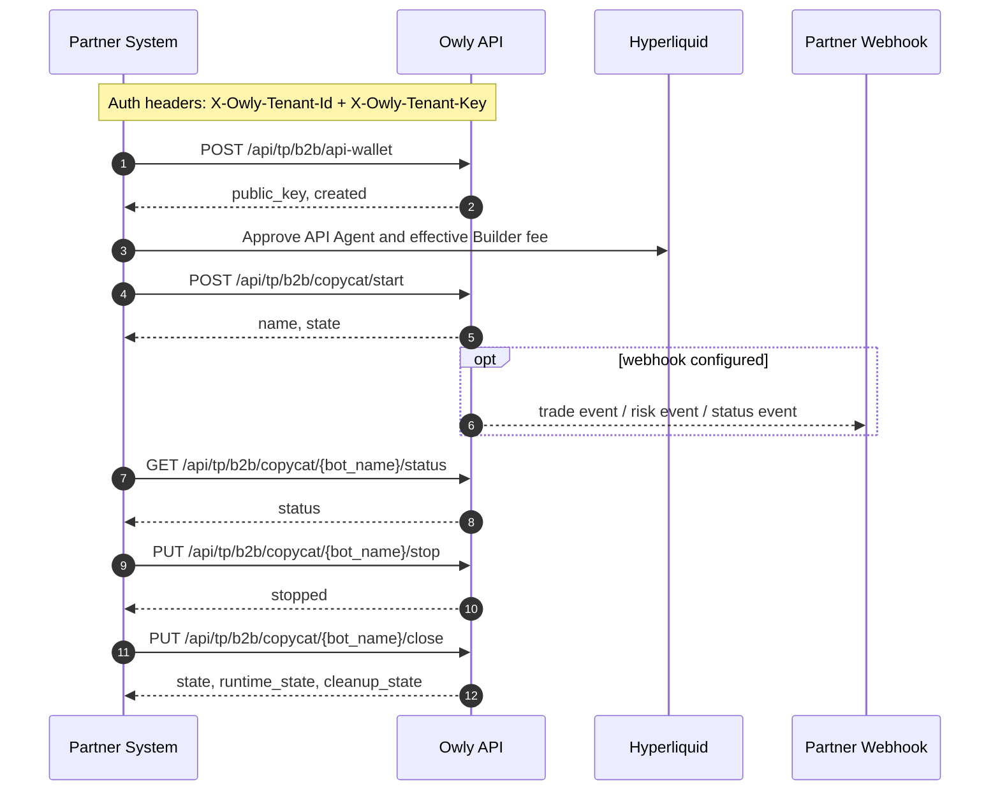

このガイドは、Owly をテナントレベルで統合するビジネスパートナー向けです。ターゲット アドレスの API ウォレットを作成する方法、戦略インスタンスを開始する方法、Webhook イベントを受信する方法、および Owly の外部 API を介して戦略ライフサイクルを管理する方法について説明します。

<Note>
すべての B2B エンドポイントはテナントの資格情報を使用して認証されます。標準のエンドユーザー製品セットアップをお探しの場合は、[コアコンセプト](/ja/guide/concepts) および[クイックスタート](/ja/guide/quick-start) から開始してください。
</Note>

## 統合フロー

推奨される順序は次のとおりです。

1. ターゲットアドレスのAPI ウォレットを作成または取得します。
2. 返された `public_key` を Hyperliquid API エージェントとして承認し、有効なビルダー料金承認を完了します。
3. オプションで、コピートレードの前に `source-check` を実行し、その後、Owly 戦略インスタンスを開始します。
4. 返されたボット識別子を、後のステータス呼び出しとライフサイクル呼び出しのために保存します。
5. 設定されている場合、Webhook 通知を受信します。



## ベース URL

| 環境 | URL |
| --- | --- |
| 製作 | `https://app.owly.fi` |
| 開発 | `https://dev-app.owly.fi` |

## 認証

すべてのリクエストには次のヘッダーが含まれている必要があります。

```http
X-Owly-Tenant-Id: <tenant_id>
X-Owly-Tenant-Key: <tenant_key>
Content-Type: application/json
```

| ヘッダー | 必須 | 説明 |
| --- | --- | --- |
| `X-Owly-Tenant-Id` | はい | Owly が発行したテナント識別子 |
| `X-Owly-Tenant-Key` | はい | Owly によって発行されたテナントの秘密 |
| `Content-Type` | JSONリクエストの場合 | `application/json`; GET リクエストには本文は必要ありません |

## 応答フォーマット

成功した応答は次のエンベロープに従います。

```json
{
  "code": 0,
  "msg": "success",
  "timestamp": 1763471388,
  "data": {}
}
```

エラー `detail` は、文字列、`code` / `message` などのフィールドを含むオブジェクト、または検証エラー リストにすることができます。開始に失敗すると、フォローアップ クエリに対してトップレベルの `bot_name` が返される場合もあります。固定された英語のエラー メッセージのみには一致しないでください。たとえば、プロトコル所有のアカウントは、一般的な B2B ウォレット フローでは追加できません。

```json
{
  "detail": {
    "code": "leveracc_dedicated_flow_required"
  }
}
```

一般的な HTTP ステータス コード:

| ステータス | 意味 |
| --- | --- |
| `400` | 無効なリクエストパラメータです |
| `401` | テナント認証に失敗しました |
| `403` | テナントまたはターゲット アカウントが利用できません |
| `404` | リソースが見つかりません |
| `409` | リソース状態の競合 |
| `422` | 本文またはフィールドの検証に失敗しました |
| `500` | 内部サービスまたは実行エラー |
| `503` | アカウントまたは認証検証の依存関係が利用できません |

## ステップ 1: API ウォレットを作成または取得する

### エンドポイント

```http
POST /api/tp/b2b/api-wallet
```

### リクエスト本文

```json
{
  "target": "0x1111111111111111111111111111111111111111"
}
```

| フィールド | タイプ | 必須 | 説明 |
| --- | --- | --- | --- |
| `target` | 文字列 | はい | 戦略を実行する EVM アドレス |
| `created` | ブール値 | いいえ | デフォルトは `false` で、既存のウォレットを再利用します。 `true` が交換を要求しています |
| `idempotency_key` | 文字列 | `created=true` のとき | 1–128 文字。 1 回転を再試行するときに同じ値を再利用する |

### 成功例

```json
{
  "code": 0,
  "msg": "success",
  "timestamp": 1763471388,
  "data": {
    "tenant_id": "tenant-demo",
    "target": "0x1111111111111111111111111111111111111111",
    "public_key": "0xaaaaaaaaaaaaaaaaaaaaaaaaaaaaaaaaaaaaaaaa",
    "created": true
  }
}
```

| フィールド | タイプ | 説明 |
| --- | --- | --- |
| `tenant_id` | 文字列 | 現在のテナントID |
| `target` | 文字列 | 要求されたターゲットアドレス |
| `public_key` | 文字列 | API Hyperliquid API エージェントとして設定する必要があるウォレット公開キー |
| `created` | ブール値 | `true` ウォレットが今作成された場合。 `false` 既存のウォレットが返却された場合 |

<Tip>
Owly は、API ウォレットの秘密鍵を安全に保管し、パートナーに返却しません。
</Tip>

ターゲットは現在、`unifiedAccount` または `dexAbstraction` モードを使用する必要があります。モードを検証できない場合、リクエストは失敗します。このエンドポイントは、ターゲット アカウント モードを切り替えません。

重要な行動:

- 同じテナントで同じ `target` に対して同じリクエストを繰り返すと、可能な限り既存のウォレットが返されます。
- `target` がすでに別のテナントまたは別の互換性のないフローによって占有されている場合、API は `409` を返します。
- ローテーション後、返された`public_key` を再度承認し、戦略ステータスを確認します。代替品を生成しても、Hyperliquid 認証は完了しません。
- 同じ冪等キーで `created=true` を再試行すると、そのローテーションからウォレットが返されます。レスポンス `created` は、この呼び出しでウォレットが作成されたかどうかを報告します。その意味はリクエストフラグとは異なります。

ローテーションリクエストの例:

```json
{
  "target": "0x1111111111111111111111111111111111111111",
  "created": true,
  "idempotency_key": "wallet-rotation-001"
}
```

## ステップ 2: API エージェントを Hyperliquid に設定する

ステップ 1 で返された `public_key` を使用し、それを Hyperliquid のターゲット アドレスの API エージェントとして設定します。

パートナーは、Hyperliquid でこれらの承認を完了します。有効なビルダーのアドレスと料金、および API エージェントを承認します。起動時に両方が検証されます。ビルダー設定はアカウント、既存の戦略、またはテナント構成から取得される場合があるため、すべてのテナントに 1 つの料金が適用されると仮定するのではなく、統合設定を確認してください。

## コピートレードソースを確認する

```http
POST /api/tp/b2b/copycat/source-check
```

同じテナント ヘッダーを使用し、1–20 EVM アドレスを送信します。

```json
{
  "sources": ["0x2222222222222222222222222222222222222222"]
}
```

成功例 `data`:

```json
{
  "results": [
    {
      "address": "0x2222222222222222222222222222222222222222",
      "eligible": true,
      "account_mode": "unifiedAccount",
      "rejection_reason": null,
      "order_risk_metrics": null
    }
  ]
}
```

このチェックでは、ソースが `unifiedAccount` を使用する必要があり、注文動作リスク チェックが有効になっている場合に履歴注文をチェックします。拒否の理由には、`account_mode_not_unified`、`high_risk_order_behavior`、または検証データが利用できないなどがあります。リスク メトリックが null になる可能性があります。この結果は、認可や実行の保証を与えません。起動時に独自の検証が実行されます。

## ステップ 3: ストラテジーインスタンスの開始

### エンドポイント

```http
POST /api/tp/b2b/copycat/start
```

### リクエスト本文

```json
{
  "config": {
    "bot_type": "copytrading",
    "target": "0x1111111111111111111111111111111111111111",
    "source": "0x2222222222222222222222222222222222222222",
    "copy_ratio": 1.0,
    "included_coins": [],
    "excluded_coins": [],
    "included_dexs": [""],
    "alerts": {
      "enable": true,
      "webhook": "https://partner.example.com/owly/callback"
    }
  }
}
```

| フィールド | タイプ | 必須 | 説明 |
| --- | --- | --- | --- |
| `config` | オブジェクト | はい | `copytrading` または `grid` 構成;パブリック エンドポイントは Hyperliquid ターゲットのみをサポートします |
| `config.alerts` | オブジェクト | いいえ | 通知設定;この例では、アラートを明示的に有効にし、Webhook を提供します。 |
| `config.alerts.webhook` | 文字列 \| ヌル | いいえ | 優先コールバックフィールド。明示的な `null` によりクリアされます |
| `webhook` | 文字列 \| ヌル | いいえ | 非推奨のトップレベル互換性フィールド。 `config.alerts.webhook` に移行 |

通常のコピー取引には `source` が必要です。グリッド ボットには有効な `grid` 構成が必要です。永久グリッドには正の `grid.total_invest` が必要で、サーバーはそこから注文サイズを導き出します。 [グリッドボット](/ja/guide/grid-bot)を参照してください。マスターウォレットまたはAPI-ウォレットの秘密鍵を送信しないでください。

### Webhook の優先順位

| ご要望の形状 | 動作 |
| --- | --- |
| 明示的 `config.alerts.webhook` | 最上位フィールドとテナントのデフォルトをオーバーライドします。明示的な `null` によりクリアされます |
| ネストされたフィールドは省略され、トップレベルの`webhook` が提供されます | 互換性フィールドを使用します。明示的な `null` によりクリアされます |
| 両方のフィールドが省略され、テナントのデフォルトが存在します | テナントのデフォルトを使用します |
| 両方のフィールドが省略され、テナントのデフォルトはありません | 既存のボット Webhook を保存します |

`config.alerts=null` だけでは、`config.alerts.webhook=null` は明示的に設定されません。配信は通知スイッチやイベント設定によっても異なります。

### 成功例

```json
{
  "code": 0,
  "msg": "success",
  "timestamp": 1763471390,
  "data": {
    "name": "bot_abc123",
    "state": "running",
    "runtime_state": "active",
    "cleanup_state": "none",
    "start_time": null,
    "uptime": null,
    "err_msg": null
  }
}
```

<Note>
応答の `name` フィールドは、ステータス、停止、およびクローズのエンドポイントによって使用される `bot_name` です。それをあなたの側に置いてください。
</Note>

## Webhook 通知

通知を有効にし、有効な Webhook を構成すると、Owly は構成された戦略通知をコールバック エンドポイントに配信できます。

Webhook カテゴリには次のものが含まれます。

- `trade event`: ストラテジーインスタンスによって生成された取引関連イベント
- `risk event`: 戦略インスタンスによって生成されるリスク制御イベント
- `status event`: 戦略状態の変更

Webhook 処理の期待:

- `2xx` を返して受信成功を確認します
- 冪等になるように受信機を設計する
- 再試行と重複配信が可能であると想定
- は、内部サービス名や内部ステートマシンではなく、Owly の外部イベント フィールドとビジネス セマンティクスのみに依存します。

## 戦略ライフサイクルのエンドポイント

### ステータスの取得

```http
GET /api/tp/b2b/copycat/{bot_name}/status
```

成功例:

```json
{
  "code": 0,
  "msg": "success",
  "timestamp": 1763471391,
  "data": {
    "name": "bot_abc123",
    "state": "running",
    "runtime_state": "active",
    "cleanup_state": "none",
    "start_time": null,
    "uptime": null,
    "err_msg": null
  }
}
```

`data` は戦略ステータス構造を使用します。 start、stop、close 呼び出しが成功すると、次の構造体も返されます。

| フィールド | 意味 |
| --- | --- |
| `name` | 後のリクエスト用の `bot_name` |
| `state` | ライフサイクル状態 (`running`、`stopped`、`terminated`、`error` など) |
| `runtime_state` | 実行状態 (`active`、`idle`、`degraded`、`risk_exit_in_progress`、`risk_exit_failed` など) |
| `cleanup_state` | `none`、`in_progress`、`completed`、または`failed` |
| `start_time` / `uptime` | 開始時刻と経過秒数。 null の可能性があります |
| `err_msg` | オプションのエラー情報 |

実行状態、クリーンアップ状態、エラーをまとめて確認します。 `state=running` だけでは、戦略が正常に注文を出していることを証明することはできません。

### 戦略を停止する

```http
PUT /api/tp/b2b/copycat/{bot_name}/stop
```

`stop` は、ポジションクローズのクリーンアップを実行せずに自動実行を停止します。既存のポジションと注文を個別に確認してください。停止状態の例:

```json
{
  "code": 0,
  "msg": "success",
  "timestamp": 1763471392,
  "data": {
    "name": "bot_abc123",
    "state": "stopped",
    "runtime_state": "stopped",
    "cleanup_state": "none",
    "start_time": null,
    "uptime": null,
    "err_msg": null
  }
}
```

### 戦略を閉じる

```http
PUT /api/tp/b2b/copycat/{bot_name}/close
```

`close` は、ポジションを閉じて関連注文を清算する試みを含む、戦略の終了とそのクリーンアップを要求します。資金を引き出したり、借入を返済したりすることはありません。 `cleanup_state` と `err_msg` を確認し、実際のポジションと注文を確認します。タイムアウトまたはクリーンアップの失敗後、次に何を行うかを決定する前に、現在のステータスをクエリします。

この例は、クリーンアップが完了した後の応答形状を示しています。すべてのクローズ要求でクリーンアップが完了することを保証するものではありません。

```json
{
  "code": 0,
  "msg": "success",
  "timestamp": 1763471393,
  "data": {
    "name": "bot_abc123",
    "state": "terminated",
    "runtime_state": "terminated",
    "cleanup_state": "completed",
    "start_time": null,
    "uptime": null,
    "err_msg": null
  }
}
```

## よくあるエラー

| ステータス | 状況 | 確認事項 |
| --- | --- | --- |
| `400` | サポートされていないターゲット モードまたは不完全な Agent / Builder 認証 | アカウントモードと有効な権限 |
| `401` | 無効なテナント資格情報 | 両方のテナントヘッダー |
| `403` | 非アクティブなテナントまたは使用できないアカウント | テナントとアカウントのステータス |
| `404` | 対象のアカウントまたはボットが見つかりません | テナント所有権と `bot_name` |
| `409` | 所有権の競合、ライフサイクルの同時操作、または互換性のない状態 | 競合を解決する前にステータスを問い合わせる |
| `422` | 無効なアドレス、冪等キー、または構成 | 現在のリクエストスキーマ |
| `500` / `503` | 実行失敗または検証依存関係が利用できない | `bot_name` とエラーの詳細を保存します。現在のステータスを問い合わせる |

エラーには、構造化されたビジネス コードまたは文字列が含まれる場合があります。タイムアウトは、起動が起こらなかったことを証明するものではありません。操作を繰り返す前に、既知の `bot_name` をクエリしてください。

## 最小限の cURL の例

### API ウォレットを作成する

```bash
curl -X POST "https://dev-app.owly.fi/api/tp/b2b/api-wallet" \
  -H "Content-Type: application/json" \
  -H "X-Owly-Tenant-Id: tenant-demo" \
  -H "X-Owly-Tenant-Key: tenant-secret" \
  -d '{
    "target": "0x1111111111111111111111111111111111111111"
  }'
```

### 戦略を開始する

```bash
curl -X POST "https://dev-app.owly.fi/api/tp/b2b/copycat/start" \
  -H "Content-Type: application/json" \
  -H "X-Owly-Tenant-Id: tenant-demo" \
  -H "X-Owly-Tenant-Key: tenant-secret" \
  -d '{
    "config": {
      "bot_type": "copytrading",
      "target": "0x1111111111111111111111111111111111111111",
      "source": "0x2222222222222222222222222222222222222222",
      "copy_ratio": 1.0,
      "included_coins": [],
      "excluded_coins": [],
      "included_dexs": [""],
      "alerts": {
        "enable": true,
        "webhook": "https://partner.example.com/owly/callback"
      }
    }
  }'
```

### ステータスのクエリ

```bash
curl -X GET "https://dev-app.owly.fi/api/tp/b2b/copycat/bot_abc123/status" \
  -H "X-Owly-Tenant-Id: tenant-demo" \
  -H "X-Owly-Tenant-Key: tenant-secret"
```

## 統合に関する推奨事項

- `api-wallet -> Hyperliquid Agent + Builder approval -> optional source-check -> start` をフォローしてください。
- 返された `bot_name` をすぐに永続化します。
- Webhook コンシューマを冪等にし、再試行を安全にします。
- Webhook イベントを Owly ビジネス通知として扱い、Owly の内部実装の詳細には依存しません。
- API ウォレットをデフォルトで再利用します。 `created=true` でローテーションをリクエストし、そのローテーションの再試行に冪等性キーを再利用します。
- 起動に失敗した場合は、テナントの資格情報、アカウント モード、エージェントとビルダーの承認、ターゲットの所有権、および戦略の構成を確認します。実行時間とクリーンアップのステータスも検査します。
