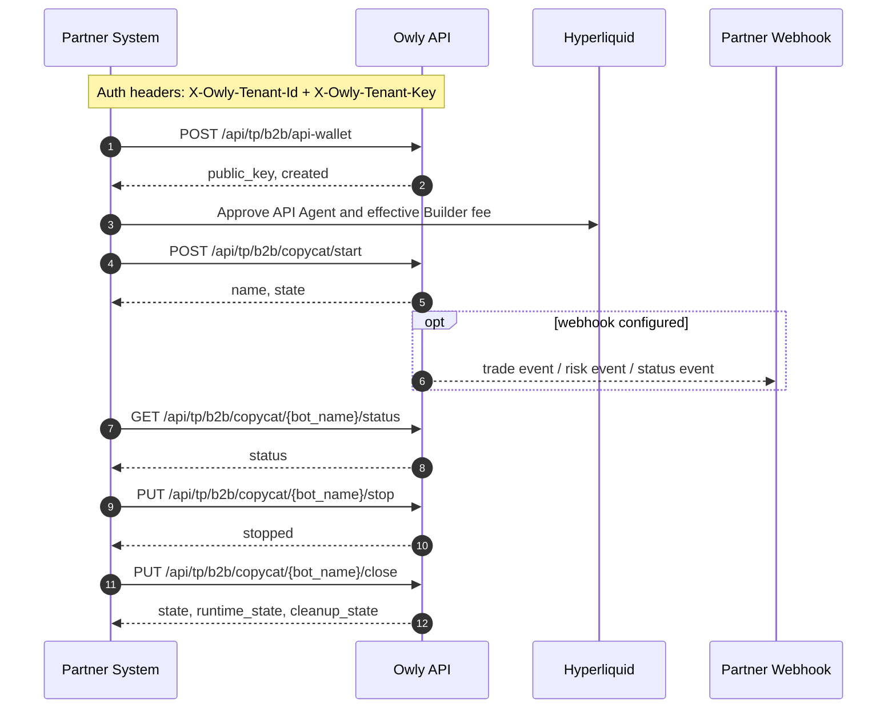

테넌트 수준에서 Owly를 통합하는 비즈니스 파트너를 위한 가이드입니다. Owly 외부 API를 통해 타겟 주소에 대한 API 지갑 생성, 전략 인스턴스 시작, 웹훅 이벤트 수신, 전략 라이프사이클 관리 방법을 설명합니다.

<Note>
모든 B2B 엔드포인트는 테넌트 자격 증명으로 인증됩니다. 표준 최종 사용자 제품 설정을 찾고 있다면 [핵심 개념](/ko/guide/concepts) 및 [빠른 시작](/ko/guide/quick-start)부터 시작하세요.
</Note>

## 통합 흐름

권장 순서는 다음과 같습니다.

1. 대상 주소에 대한 API 지갑을 생성하거나 가져옵니다.
2. 반환된 `public_key`를 Hyperliquid API 에이전트로 승인하고 유효한 빌더 수수료 승인을 완료합니다.
3. 선택적으로 카피 트레이딩 전에 `source-check`를 실행한 다음 Owly 전략 인스턴스를 시작합니다.
4. 나중에 상태 및 수명주기 호출을 위해 반환된 봇 식별자를 저장하세요.
5. 구성된 경우 웹훅 알림을 받습니다.



## 기본 URL

| 환경 | URL |
| --- | --- |
| 제작 | `https://app.owly.fi` |
| 개발 | `https://dev-app.owly.fi` |

## 인증

모든 요청에는 다음 헤더가 포함되어야 합니다.

```http
X-Owly-Tenant-Id: <tenant_id>
X-Owly-Tenant-Key: <tenant_key>
Content-Type: application/json
```

| 헤더 | 필수 | 설명 |
| --- | --- | --- |
| `X-Owly-Tenant-Id` | 예 | Owly에서 발급한 테넌트 식별자 |
| `X-Owly-Tenant-Key` | 예 | Owly에서 발급한 테넌트 비밀번호 |
| `Content-Type` | JSON 요청의 경우 | `application/json`; GET 요청에는 본문이 필요하지 않습니다. |

## 응답 형식

성공적인 응답은 다음 봉투를 따릅니다.

```json
{
  "code": 0,
  "msg": "success",
  "timestamp": 1763471388,
  "data": {}
}
```

오류 `detail`는 문자열, `code` / `message`와 같은 필드를 포함하는 객체 또는 유효성 검사 오류 목록일 수 있습니다. 시작 실패는 후속 쿼리에 대해 최상위 `bot_name`를 반환할 수도 있습니다. 수정된 영어 오류 메시지만 일치시키지 마세요. 예를 들어, 프로토콜 소유 계정은 일반 B2B 지갑 흐름을 통해 추가할 수 없습니다.

```json
{
  "detail": {
    "code": "leveracc_dedicated_flow_required"
  }
}
```

일반적인 HTTP 상태 코드:

| 상태 | 의미 |
| --- | --- |
| `400` | 잘못된 요청 매개변수 |
| `401` | 테넌트 인증 실패 |
| `403` | 테넌트 또는 대상 계정을 사용할 수 없습니다. |
| `404` | 리소스를 찾을 수 없습니다. |
| `409` | 리소스 상태 충돌 |
| `422` | 본문 또는 필드 검증 실패 |
| `500` | 내부 서비스 또는 실행 오류 |
| `503` | 계정 또는 승인 확인 종속성을 사용할 수 없습니다. |

## 1 단계: API 지갑 생성 또는 가져오기

### 엔드포인트

```http
POST /api/tp/b2b/api-wallet
```

### 요청 본문

```json
{
  "target": "0x1111111111111111111111111111111111111111"
}
```

| 필드 | 종류 | 필수 | 설명 |
| --- | --- | --- | --- |
| `target` | 문자열 | 예 | 전략을 실행할 EVM 주소 |
| `created` | 부울 | 아니요 | 기존 지갑을 재사용하려면 기본값은 `false`입니다. `true` 교체를 요청합니다 |
| `idempotency_key` | 문자열 | `created=true`일 때 | 1–128 문자; 한 회전을 다시 시도할 때 동일한 값을 재사용합니다. |

### 성공사례

```json
{
  "code": 0,
  "msg": "success",
  "timestamp": 1763471388,
  "data": {
    "tenant_id": "tenant-demo",
    "target": "0x1111111111111111111111111111111111111111",
    "public_key": "0xaaaaaaaaaaaaaaaaaaaaaaaaaaaaaaaaaaaaaaaa",
    "created": true
  }
}
```

| 필드 | 종류 | 설명 |
| --- | --- | --- |
| `tenant_id` | 문자열 | 현재 테넌트 ID |
| `target` | 문자열 | 요청된 대상 주소 |
| `public_key` | 문자열 | API Hyperliquid API 에이전트로 설정해야 하는 지갑 공개키 |
| `created` | 부울 | `true` 지갑이 지금 생성된 경우; `false` 기존 지갑을 반납한 경우 |

<Tip>
Owly API 지갑 개인키를 안전하게 보관하고 파트너에게 돌려주지 않습니다.
</Tip>

대상은 현재 `unifiedAccount` 또는 `dexAbstraction` 모드를 사용해야 합니다. 모드를 확인할 수 없으면 요청이 실패합니다. 이 끝점은 대상 계정 모드를 전환하지 않습니다.

중요 동작:

- 동일한 테넌트 내에서 동일한 `target`에 대해 동일한 요청을 반복하면 가능할 때마다 기존 지갑을 반환합니다.
- `target`가 이미 다른 테넌트 또는 다른 호환되지 않는 흐름에 의해 점유된 경우 API는 `409`를 반환합니다.
- 로테이션 후 반환된 `public_key`를 다시 승인하고 전략현황을 확인합니다. 교체품을 생성해도 Hyperliquid 승인이 완료되지 않습니다.
- 동일한 멱등성 키를 사용하여 `created=true`를 다시 시도하면 해당 순환에서 지갑이 반환됩니다. 응답 `created`은 이 호출이 지갑을 생성했는지 여부를 보고합니다. 그 의미는 요청 플래그와 다릅니다.

회전 요청 예시:

```json
{
  "target": "0x1111111111111111111111111111111111111111",
  "created": true,
  "idempotency_key": "wallet-rotation-001"
}
```

## 2 단계: API 에이전트를 Hyperliquid에 설정

1 단계에서 반환된 `public_key`를 사용하여 Hyperliquid의 대상 주소에 대한 API Agent로 설정합니다.

파트너는 Hyperliquid에 이러한 승인을 완료합니다. 유효한 빌더 주소와 수수료는 물론 API 에이전트도 승인합니다. 시작 시 두 가지를 모두 확인합니다. 빌더 설정은 계정, 기존 전략 또는 테넌트 구성에서 나올 수 있으므로 모든 테넌트에 하나의 수수료가 적용된다고 가정하는 대신 통합 설정을 확인하세요.

## 카피 트레이딩 소스 확인

```http
POST /api/tp/b2b/copycat/source-check
```

동일한 테넌트 헤더를 사용하고 1–20 EVM 주소를 제출하세요.

```json
{
  "sources": ["0x2222222222222222222222222222222222222222"]
}
```

성공 사례 `data`:

```json
{
  "results": [
    {
      "address": "0x2222222222222222222222222222222222222222",
      "eligible": true,
      "account_mode": "unifiedAccount",
      "rejection_reason": null,
      "order_risk_metrics": null
    }
  ]
}
```

이 확인을 위해서는 소스가 `unifiedAccount`를 사용해야 하며 주문 행동 위험 확인이 활성화된 경우 과거 주문을 확인해야 합니다. 거부 사유에는 `account_mode_not_unified`, `high_risk_order_behavior` 또는 확인할 수 없는 확인 데이터가 포함됩니다. 위험 측정항목은 null일 수 있습니다. 이 결과는 승인이나 실행 보장을 부여하지 않습니다. 시작은 자체 유효성 검사를 수행합니다.

## 단계 3: 전략 인스턴스 시작

### 엔드포인트

```http
POST /api/tp/b2b/copycat/start
```

### 요청 본문

```json
{
  "config": {
    "bot_type": "copytrading",
    "target": "0x1111111111111111111111111111111111111111",
    "source": "0x2222222222222222222222222222222222222222",
    "copy_ratio": 1.0,
    "included_coins": [],
    "excluded_coins": [],
    "included_dexs": [""],
    "alerts": {
      "enable": true,
      "webhook": "https://partner.example.com/owly/callback"
    }
  }
}
```

| 필드 | 종류 | 필수 | 설명 |
| --- | --- | --- | --- |
| `config` | 물체 | 예 | `copytrading` 또는 `grid` 구성; 공개 엔드포인트는 Hyperliquid 대상만 지원합니다. |
| `config.alerts` | 물체 | 아니요 | 알림 설정; 이 예에서는 명시적으로 경고를 활성화하고 웹후크를 제공합니다. |
| `config.alerts.webhook` | 문자열 \| null | 아니요 | 기본 콜백 필드; 명시적 `null`는 이를 지웁니다. |
| `webhook` | 문자열 \| null | 아니요 | 더 이상 사용되지 않는 최상위 호환성 필드입니다. `config.alerts.webhook`로 이전 |

일반 카피 트레이딩에는 `source`가 필요합니다. 그리드 봇에는 유효한 `grid` 구성이 필요합니다. 영구 그리드에는 서버가 주문 크기를 도출하는 양수 `grid.total_invest`가 필요합니다. [그리드 봇](/ko/guide/grid-bot)을 참조하세요. 마스터 지갑 또는 API 지갑 개인 키를 제출하지 마세요.

### 웹훅 우선순위

| 요청 모양 | 행동 |
| --- | --- |
| 명시적 `config.alerts.webhook` | 최상위 필드 및 테넌트 기본값을 재정의합니다. 명시적 `null`는 이를 지웁니다. |
| 중첩 필드 생략, 최상위 `webhook` 제공 | 호환성 필드를 사용하세요. 명시적 `null`는 이를 지웁니다. |
| 두 필드 모두 생략, 테넌트 기본값 존재 | 테넌트 기본값 사용 |
| 두 필드 모두 생략, 테넌트 기본값 없음 | 기존 봇 웹훅 보존 |

`config.alerts=null`만으로는 `config.alerts.webhook=null`을 명시적으로 설정하지 않습니다. 배송도 알림 스위치 및 이벤트 설정에 따라 달라집니다.

### 성공사례

```json
{
  "code": 0,
  "msg": "success",
  "timestamp": 1763471390,
  "data": {
    "name": "bot_abc123",
    "state": "running",
    "runtime_state": "active",
    "cleanup_state": "none",
    "start_time": null,
    "uptime": null,
    "err_msg": null
  }
}
```

<Note>
응답의 `name` 필드는 상태, 중지 및 종료 엔드포인트에서 사용되는 `bot_name`입니다. 당신 편에서 그것을 유지하십시오.
</Note>

## 웹훅 알림

알림이 활성화되고 유효한 웹훅이 구성되면 Owly는 구성된 전략 알림을 콜백 엔드포인트에 전달할 수 있습니다.

웹훅 카테고리에는 다음이 포함됩니다.

- `trade event`: 전략 인스턴스에서 생성된 트레이딩 관련 이벤트
- `risk event`: 전략 인스턴스에 의해 생성된 위험 제어 이벤트
- `status event`: 전략 상태 변경

웹훅 처리 기대사항:

- `2xx`를 반환하여 성공적인 수신을 확인합니다.
- 수신기를 멱등성으로 설계합니다.
- 재시도 및 중복 전달이 가능하다고 가정
- 내부 서비스 이름이나 내부 상태 시스템이 아닌 Owly의 외부 이벤트 필드와 비즈니스 의미 체계에만 의존합니다.

## 전략 라이프사이클 엔드포인트

### 상태 가져오기

```http
GET /api/tp/b2b/copycat/{bot_name}/status
```

성공 사례:

```json
{
  "code": 0,
  "msg": "success",
  "timestamp": 1763471391,
  "data": {
    "name": "bot_abc123",
    "state": "running",
    "runtime_state": "active",
    "cleanup_state": "none",
    "start_time": null,
    "uptime": null,
    "err_msg": null
  }
}
```

`data`는 전략 상태 구조를 사용합니다. 성공적인 시작, 중지 및 닫기 호출도 이 구조를 반환합니다.

| 필드 | 의미 |
| --- | --- |
| `name` | 이후 요청을 위한 `bot_name` |
| `state` | 수명 주기 상태(예: `running`, `stopped`, `terminated` 또는 `error`) |
| `runtime_state` | 실행 상태(예: `active`, `idle`, `degraded`, `risk_exit_in_progress` 또는 `risk_exit_failed`) |
| `cleanup_state` | `none`, `in_progress`, `completed` 또는 `failed` |
| `start_time` / `uptime` | 시작 시간 및 경과 시간(초); null일 수 있음 |
| `err_msg` | 선택적 오류 정보 |

실행상태, 정리상태, 오류를 함께 확인해보세요. `state=running`만으로는 해당 전략이 정상적으로 주문되고 있음을 증명할 수 없습니다.

### 전략 중지

```http
PUT /api/tp/b2b/copycat/{bot_name}/stop
```

`stop` 위치 닫기 정리를 실행하지 않고 자동 실행을 중지합니다. 기존 포지션과 주문을 별도로 확인하세요. 중지된 상태의 예:

```json
{
  "code": 0,
  "msg": "success",
  "timestamp": 1763471392,
  "data": {
    "name": "bot_abc123",
    "state": "stopped",
    "runtime_state": "stopped",
    "cleanup_state": "none",
    "start_time": null,
    "uptime": null,
    "err_msg": null
  }
}
```

### 전략 종료

```http
PUT /api/tp/b2b/copycat/{bot_name}/close
```

`close` 포지션 청산 및 관련 주문 청산 시도를 포함하여 전략 종료 및 정리를 요청합니다. 자금을 인출하거나 차용금을 상환하지 않습니다. `cleanup_state`, `err_msg`를 확인하고 실제 포지션과 주문을 확인해보세요. 시간 초과 또는 정리 실패 후 다음에 수행할 작업을 결정하기 전에 현재 상태를 쿼리합니다.

이 예는 정리가 완료된 후의 응답 형태를 보여줍니다. 모든 닫기 요청이 정리를 완료한다고 보장하지는 않습니다.

```json
{
  "code": 0,
  "msg": "success",
  "timestamp": 1763471393,
  "data": {
    "name": "bot_abc123",
    "state": "terminated",
    "runtime_state": "terminated",
    "cleanup_state": "completed",
    "start_time": null,
    "uptime": null,
    "err_msg": null
  }
}
```

## 일반적인 오류

| 상태 | 상황 | 확인사항 |
| --- | --- | --- |
| `400` | 지원되지 않는 대상 모드 또는 불완전한 에이전트/빌더 인증 | 계정 모드 및 유효 인증 |
| `401` | 잘못된 테넌트 자격 증명 | 두 테넌트 헤더 모두 |
| `403` | 비활성 테넌트 또는 사용할 수 없는 계정 | 테넌트 및 계정 상태 |
| `404` | 대상 계정 또는 봇을 찾을 수 없습니다 | 임차인 소유권 및 `bot_name` |
| `409` | 소유권 충돌, 동시 수명 주기 작업 또는 호환되지 않는 상태 | 충돌 해결 전 상태 조회 |
| `422` | 잘못된 주소, 멱등성 키 또는 구성 | 현재 요청 스키마 |
| `500` / `503` | 실행 실패 또는 확인 불가 종속성 | `bot_name` 및 오류 세부정보를 보존합니다. 현재 상태 쿼리 |

오류에는 구조화된 비즈니스 코드나 문자열이 포함될 수 있습니다. 시간 초과는 시작이 발생하지 않았다는 것을 증명하지 않습니다. 작업을 반복하기 전에 알려진 `bot_name`를 쿼리하세요.

## 최소 cURL 예

### API 지갑 만들기

```bash
curl -X POST "https://dev-app.owly.fi/api/tp/b2b/api-wallet" \
  -H "Content-Type: application/json" \
  -H "X-Owly-Tenant-Id: tenant-demo" \
  -H "X-Owly-Tenant-Key: tenant-secret" \
  -d '{
    "target": "0x1111111111111111111111111111111111111111"
  }'
```

### 전략 시작

```bash
curl -X POST "https://dev-app.owly.fi/api/tp/b2b/copycat/start" \
  -H "Content-Type: application/json" \
  -H "X-Owly-Tenant-Id: tenant-demo" \
  -H "X-Owly-Tenant-Key: tenant-secret" \
  -d '{
    "config": {
      "bot_type": "copytrading",
      "target": "0x1111111111111111111111111111111111111111",
      "source": "0x2222222222222222222222222222222222222222",
      "copy_ratio": 1.0,
      "included_coins": [],
      "excluded_coins": [],
      "included_dexs": [""],
      "alerts": {
        "enable": true,
        "webhook": "https://partner.example.com/owly/callback"
      }
    }
  }'
```

### 쿼리 상태

```bash
curl -X GET "https://dev-app.owly.fi/api/tp/b2b/copycat/bot_abc123/status" \
  -H "X-Owly-Tenant-Id: tenant-demo" \
  -H "X-Owly-Tenant-Key: tenant-secret"
```

## 통합 권장 사항

- `api-wallet -> Hyperliquid Agent + Builder approval -> optional source-check -> start`을 팔로우하세요.
- 반환된 `bot_name`를 즉시 유지합니다.
- 웹훅 소비자를 멱등성이 있고 재시도가 안전하도록 만듭니다.
- 웹훅 이벤트를 Owly 비즈니스 알림으로 처리하고 Owly 내부 구현 세부정보에 의존하지 마세요.
- 기본적으로 지갑을 재사용 API 합니다. `created=true`로 회전을 요청하고 해당 회전을 재시도하기 위해 멱등성 키를 재사용합니다.
- 시작에 실패하면 테넌트 자격 증명, 계정 모드, Agent 및 Builder 승인, 대상 소유권, 전략 구성을 확인하세요. 런타임 및 정리 상태도 검사합니다.
