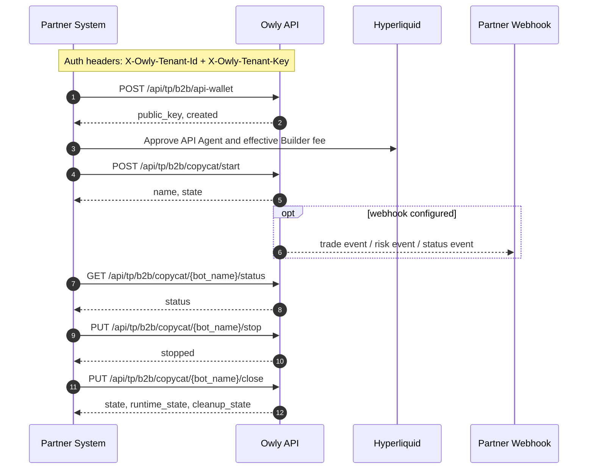

Это руководство предназначено для деловых партнеров, интегрирующих Owly на уровне клиента. В нем объясняется, как создать API-кошелёк для целевого адреса, запустить экземпляр стратегии, получать события веб-перехватчика и управлять жизненным циклом стратегии через внешний API Owly.

<Note>
Все конечные точки B2B аутентифицируются с использованием учетных данных арендатора. Если вам нужна стандартная настройка продукта для конечного пользователя, начните с [Основные понятия](/ru/guide/concepts) и [Быстрый старт](/ru/guide/quick-start).
</Note>

## Процесс интеграции

Рекомендуемый порядок:

1. Создайте или получите API-кошелёк для целевого адреса.
2. Утвердите возвращенный `public_key` в качестве агента Hyperliquid API и завершите действующую авторизацию комиссии Builder.
3. При необходимости запустите `source-check` перед копи-трейдингом, затем запустите экземпляр стратегии Owly.
4. Сохраните возвращенный идентификатор бота для последующих вызовов статуса и жизненного цикла.
5. Получать уведомления веб-перехватчика, если это настроено.



## Базовый URL-адрес

| Окружающая среда | URL-адрес |
| --- | --- |
| Производство | `https://app.owly.fi` |
| Разработка | `https://dev-app.owly.fi` |

## Аутентификация

Каждый запрос должен включать следующие заголовки:

```http
X-Owly-Tenant-Id: <tenant_id>
X-Owly-Tenant-Key: <tenant_key>
Content-Type: application/json
```

| Заголовок | Обязательно | Описание |
| --- | --- | --- |
| `X-Owly-Tenant-Id` | Да | Идентификатор арендатора, выданный Owly |
| `X-Owly-Tenant-Key` | Да | Секрет арендатора, выданный Owly |
| `Content-Type` | Для запросов JSON | `application/json`; GET-запросам не нужно тело |

## Формат ответа

Успешные ответы следуют за этим конвертом:

```json
{
  "code": 0,
  "msg": "success",
  "timestamp": 1763471388,
  "data": {}
}
```

Ошибка `detail` может быть строкой, объектом, содержащим поля, например `code` / `message`, или списком ошибок проверки. Ошибки запуска также могут возвращать `bot_name` верхнего уровня для последующих запросов. Не соответствует только фиксированному сообщению об ошибке на английском языке. Например, учетные записи, принадлежащие протоколу, не могут быть добавлены через общий поток B2B-кошелька:

```json
{
  "detail": {
    "code": "leveracc_dedicated_flow_required"
  }
}
```

Общие коды состояния HTTP:

| Статус | Значение |
| --- | --- |
| `400` | Неверные параметры запроса. |
| `401` | Ошибка аутентификации арендатора. |
| `403` | Арендатор или целевая учетная запись недоступна. |
| `404` | Ресурс не найден |
| `409` | Конфликт состояния ресурсов |
| `422` | Не удалось выполнить проверку тела или поля. |
| `500` | Внутренняя ошибка службы или выполнения. |
| `503` | Зависимость проверки учетной записи или авторизации недоступна. |

## Шаг 1: Создайте или получите API-кошелёк

### Конечная точка

```http
POST /api/tp/b2b/api-wallet
```

### Тело запроса

```json
{
  "target": "0x1111111111111111111111111111111111111111"
}
```

| Поле строка | Тип | Обязательно | Описание |
| --- | --- | --- | --- |
| `target` | нить | Да | Адрес EVM, на котором будет запускаться стратегия. |
| `created` | логическое значение | Нет | По умолчанию `false` для повторного использования существующего кошелька; `true` запрашивает замену |
| `idempotency_key` | нить | Когда `created=true` символы | 1–128; повторно используйте одно и то же значение при повторной попытке одного вращения |

### Пример успеха

```json
{
  "code": 0,
  "msg": "success",
  "timestamp": 1763471388,
  "data": {
    "tenant_id": "tenant-demo",
    "target": "0x1111111111111111111111111111111111111111",
    "public_key": "0xaaaaaaaaaaaaaaaaaaaaaaaaaaaaaaaaaaaaaaaa",
    "created": true
  }
}
```

| Поле строка | Тип | Описание |
| --- | --- | --- |
| `tenant_id` | нить | Текущий идентификатор арендатора |
| `target` | нить | Запрошенный целевой адрес |
| `public_key` | нить | API Открытый ключ кошелька, который должен быть установлен в качестве Hyperliquid API Агента |
| `created` | логическое значение | `true`, если кошелек создан сейчас; `false`, если был возвращен существующий кошелек |

<Tip>
Owly надежно хранит закрытый ключ API-кошелька и не возвращает его партнеру.
</Tip>

Цель в настоящее время должна использовать режим `unifiedAccount` или `dexAbstraction`. Запросы завершаются неудачно, если режим не может быть проверен. Эта конечная точка не переключает режим целевой учетной записи.

Важное поведение:

- Повторение одного и того же запроса для одного и того же `target` под тем же клиентом, когда это возможно, возвращает существующий кошелек.
- Если `target` уже занят другим арендатором или другим несовместимым потоком, API возвращает `409`.
- После ротации еще раз утвердите возвращенный `public_key` и проверьте статус стратегии. Создание замены не завершает авторизацию Hyperliquid.
- Повторная попытка `created=true` с тем же ключом идемпотентности возвращает кошелек из этого вращения. Ответ `created` сообщает, создал ли этот вызов кошелек; его значение отличается от флага запроса.

Пример запроса на ротацию:

```json
{
  "target": "0x1111111111111111111111111111111111111111",
  "created": true,
  "idempotency_key": "wallet-rotation-001"
}
```

## Шаг 2: Установите агента API на Hyperliquid.

Используйте `public_key`, полученный на шаге 1, и установите его в качестве агента API для целевого адреса на Hyperliquid.

Партнер завершает эти авторизации Hyperliquid. Утвердите действующий адрес и комиссию Builder, а также агента API: запуск проверяет и то, и другое. Настройки Builder могут быть взяты из учетной записи, существующей стратегии или конфигурации клиента, поэтому подтвердите настройки интеграции, а не предполагайте, что к каждому арендатору применяется одна плата.

## Проверьте источники копи-трейдинга

```http
POST /api/tp/b2b/copycat/source-check
```

Используйте те же заголовки арендатора и отправьте 1–20 адреса EVM:

```json
{
  "sources": ["0x2222222222222222222222222222222222222222"]
}
```

Пример успеха `data`:

```json
{
  "results": [
    {
      "address": "0x2222222222222222222222222222222222222222",
      "eligible": true,
      "account_mode": "unifiedAccount",
      "rejection_reason": null,
      "order_risk_metrics": null
    }
  ]
}
```

Для предварительной проверки источник должен использовать режим `unifiedAccount`. Если включена проверка риска по поведению ордеров, также проверяется их история. Среди причин отклонения могут быть `account_mode_not_unified`, `high_risk_order_behavior` или недоступность данных для проверки. Поле `order_risk_metrics` может содержать `null`, если метрики не возвращаются. Эта проверка не даёт разрешения на запуск и не гарантирует исполнение стратегии. При запуске выполняется отдельная проверка.

## Шаг 3: Запустите экземпляр стратегии.

### Конечная точка

```http
POST /api/tp/b2b/copycat/start
```

### Тело запроса

```json
{
  "config": {
    "bot_type": "copytrading",
    "target": "0x1111111111111111111111111111111111111111",
    "source": "0x2222222222222222222222222222222222222222",
    "copy_ratio": 1.0,
    "included_coins": [],
    "excluded_coins": [],
    "included_dexs": [""],
    "alerts": {
      "enable": true,
      "webhook": "https://partner.example.com/owly/callback"
    }
  }
}
```

| Поле строка | Тип | Обязательно | Описание |
| --- | --- | --- | --- |
| `config` | объект конфигурация | Да | `copytrading` или `grid`; общедоступные конечные точки поддерживают только цели Hyperliquid |
| `config.alerts` | объект конфигурация | Нет | Настройки уведомлений; пример явно включает оповещения и предоставляет вебхук |
| `config.alerts.webhook` | строка \| `null` | Нет | Рекомендуемое поле для URL обратного вызова. Явное значение `null` очищает адрес webhook |
| `webhook` | строка \| `null` | Нет | Устаревшее поле верхнего уровня для обратной совместимости. Используйте `config.alerts.webhook` |

Для обычной торговли копиями требуется `source`; грид-ботам требуется действительная конфигурация `grid`. Для вечных сеток требуется положительное значение `grid.total_invest`, на основе которого сервер определяет размер ордера. См. [Grid Bot](/ru/guide/grid-bot). Не отправляйте приватные ключи главного кошелька или API-кошелька.

### Приоритет вебхука

| Форма запроса | Поведение |
| --- | --- |
| Явный `config.alerts.webhook` | Переопределяет поле верхнего уровня и значение по умолчанию для клиента; явный `null` очищает его |
| Вложенное поле опущено, указан верхний уровень `webhook` | Используйте поле совместимости; явный `null` очищает его |
| Оба поля опущены, существует значение по умолчанию для арендатора. | Использовать арендатора по умолчанию. |
| Оба поля опущены, нет значения по умолчанию для арендатора. | Сохранить существующий вебхук бота. |

`config.alerts=null` сам по себе не устанавливает `config.alerts.webhook=null` явно. Доставка также зависит от переключателя уведомлений и настроек событий.

### Пример успеха

```json
{
  "code": 0,
  "msg": "success",
  "timestamp": 1763471390,
  "data": {
    "name": "bot_abc123",
    "state": "running",
    "runtime_state": "active",
    "cleanup_state": "none",
    "start_time": null,
    "uptime": null,
    "err_msg": null
  }
}
```

<Note>
Поле `name` в ответе — это `bot_name`, используемое конечными точками состояния, остановки и закрытия. Настаивайте на своей стороне.
</Note>

## Уведомления веб-перехватчика

Если уведомления включены и настроен действительный веб-перехватчик, Owly может доставлять настроенные уведомления стратегии в вашу конечную точку обратного вызова.

Категории веб-перехватчиков включают в себя:

- `trade event`: события, связанные с торговлей, создаваемые экземпляром стратегии.
- `risk event`: события контроля риска, создаваемые экземпляром стратегии.
- `status event`: изменения состояния стратегии

Ожидания по обработке вебхуков:

- возвращает `2xx`, чтобы подтвердить успешное получение
- спроектируйте приемник идемпотентным.
- предполагается, что возможны повторные попытки и дублированные доставки.
- полагается только на внешние поля событий и бизнес-семантику Owly, а не на внутренние имена служб или внутренние конечные автоматы.

## Конечные точки жизненного цикла стратегии

### Получить статус

```http
GET /api/tp/b2b/copycat/{bot_name}/status
```

Пример успеха:

```json
{
  "code": 0,
  "msg": "success",
  "timestamp": 1763471391,
  "data": {
    "name": "bot_abc123",
    "state": "running",
    "runtime_state": "active",
    "cleanup_state": "none",
    "start_time": null,
    "uptime": null,
    "err_msg": null
  }
}
```

`data` использует структуру статуса стратегии. Успешные вызовы start, stop и close также возвращают эту структуру:

| Поле строка | Значение |
| --- | --- |
| `name` | `bot_name` для последующих запросов. |
| `state` | Состояние жизненного цикла, например `running`, `stopped`, `terminated` или `error`. |
| `runtime_state` | Состояние выполнения, например `active`, `idle`, `degraded`, `risk_exit_in_progress` или `risk_exit_failed` |
| `cleanup_state` | `none`, `in_progress`, `completed` или `failed` |
| `start_time` / `uptime` | Время запуска и продолжительность работы в секундах. Эти поля могут содержать `null` |
| `err_msg` | Дополнительная информация об ошибке. |

Проверьте состояние выполнения, состояние очистки и ошибки вместе. `state=running` сам по себе не доказывает, что стратегия размещает ордера нормально.

### Остановить стратегию

```http
PUT /api/tp/b2b/copycat/{bot_name}/stop
```

`stop` останавливает автоматическое выполнение без выполнения очистки закрытия позиции. Отдельно проверяйте существующие позиции и ордера. Пример остановленного статуса:

```json
{
  "code": 0,
  "msg": "success",
  "timestamp": 1763471392,
  "data": {
    "name": "bot_abc123",
    "state": "stopped",
    "runtime_state": "stopped",
    "cleanup_state": "none",
    "start_time": null,
    "uptime": null,
    "err_msg": null
  }
}
```

### Закрыть стратегию

```http
PUT /api/tp/b2b/copycat/{bot_name}/close
```

`close` запрашивает завершение стратегии и ее очистку, включая попытки закрытия позиций и очистки связанных ордеров. Он не выводит средства и не погашает займы. Проверьте `cleanup_state` и `err_msg` и проверьте фактические позиции и ордера. После тайм-аута или сбоя очистки запросите текущий статус, прежде чем решить, что делать дальше.

В этом примере показана форма ответа после завершения очистки; он не гарантирует, что каждый запрос на закрытие завершит очистку:

```json
{
  "code": 0,
  "msg": "success",
  "timestamp": 1763471393,
  "data": {
    "name": "bot_abc123",
    "state": "terminated",
    "runtime_state": "terminated",
    "cleanup_state": "completed",
    "start_time": null,
    "uptime": null,
    "err_msg": null
  }
}
```

## Распространенные ошибки

| Статус | Ситуация | Что проверить |
| --- | --- | --- |
| `400` | Неподдерживаемый целевой режим или неполная авторизация агента/разработчика. | Режим учетной записи и эффективные авторизации |
| `401` | Неверные учетные данные арендатора. | Оба заголовка арендатора |
| `403` | Неактивный клиент или недоступная учетная запись. | Статус арендатора и аккаунта |
| `404` | Целевой аккаунт или бот не найден | Право собственности арендатора и `bot_name` |
| `409` | Конфликт владения, одновременная операция жизненного цикла или несовместимое состояние. | Запрос статуса перед разрешением конфликта |
| `422` | Неверный адрес, ключ идемпотентности или конфигурация. | Текущая схема запроса |
| `500` / `503` | Сбой выполнения или недоступная зависимость проверки | Сохранить `bot_name` и сведения об ошибке; запросить текущий статус |

Ошибки могут содержать структурированные бизнес-коды или строки. Тайм-аут не доказывает, что запуск никогда не происходил: запросите известный `bot_name` перед повторением операции.

## Пример минимального cURL

### Создайте API-кошелёк

```bash
curl -X POST "https://dev-app.owly.fi/api/tp/b2b/api-wallet" \
  -H "Content-Type: application/json" \
  -H "X-Owly-Tenant-Id: tenant-demo" \
  -H "X-Owly-Tenant-Key: tenant-secret" \
  -d '{
    "target": "0x1111111111111111111111111111111111111111"
  }'
```

### Начать стратегию

```bash
curl -X POST "https://dev-app.owly.fi/api/tp/b2b/copycat/start" \
  -H "Content-Type: application/json" \
  -H "X-Owly-Tenant-Id: tenant-demo" \
  -H "X-Owly-Tenant-Key: tenant-secret" \
  -d '{
    "config": {
      "bot_type": "copytrading",
      "target": "0x1111111111111111111111111111111111111111",
      "source": "0x2222222222222222222222222222222222222222",
      "copy_ratio": 1.0,
      "included_coins": [],
      "excluded_coins": [],
      "included_dexs": [""],
      "alerts": {
        "enable": true,
        "webhook": "https://partner.example.com/owly/callback"
      }
    }
  }'
```

### Статус запроса

```bash
curl -X GET "https://dev-app.owly.fi/api/tp/b2b/copycat/bot_abc123/status" \
  -H "X-Owly-Tenant-Id: tenant-demo" \
  -H "X-Owly-Tenant-Key: tenant-secret"
```

## Рекомендации по интеграции

- Следуйте `api-wallet -> Hyperliquid Agent + Builder approval -> optional source-check -> start`.
- Немедленно сохраните возвращенный `bot_name`.
- Сделать потребителей веб-перехватчиков идемпотентными и безопасными для повторных попыток.
- Обрабатывать события веб-перехватчика как бизнес-уведомления Owly и не зависеть от деталей внутренней реализации Owly.
- Повторное использование API-кошельки по умолчанию. Запросите вращение с помощью `created=true` и повторно используйте ключ идемпотентности для повторных попыток этого вращения.
- Если запуск не удался, проверьте учетные данные арендатора, режим учетной записи, утверждения агента и комиссии Builder, целевое владение и конфигурацию стратегии; также проверьте время выполнения и состояние очистки.
