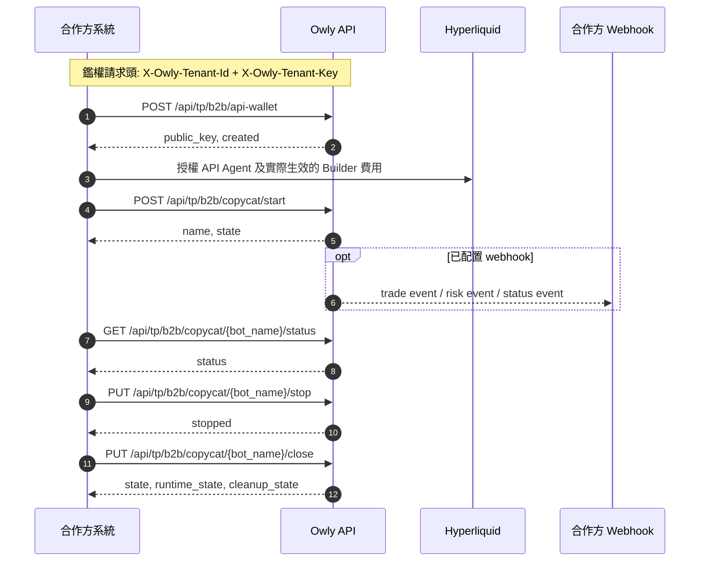

這篇文件面向與 Owly 進行租戶級對接的合作方，說明如何為目標地址建立 API Wallet、啟動策略例項、接收 webhook 事件，以及通過外部 API 管理策略生命週期。

<Note>
所有 B2B 介面都使用租戶級憑證鑑權。如果你要了解普通使用者如何開始使用 Owly，請先閱讀 [核心概念](/zh-hant/guide/concepts) 和 [快速入門](/zh-hant/guide/quick-start)。
</Note>

## 接入流程

推薦按下面的順序完成接入：

1. 為目標地址建立或獲取 API Wallet。
2. 將返回的 `public_key` 設定為 Hyperliquid API Agent，並完成有效的 Builder 費用授權。
3. 跟單前可呼叫 `source-check` 預檢交易員，再啟動 Owly 策略例項。
4. 儲存返回的 Bot 標識，後續用於狀態查詢和生命週期管理。
5. 如果配置了 webhook，接收 Owly 主動推送的事件通知。



## Base URL

| 環境 | URL |
| --- | --- |
| 生產環境 | `https://app.owly.fi` |
| 開發環境 | `https://dev-app.owly.fi` |

## 鑑權方式

每個請求都需要攜帶以下請求頭：

```http
X-Owly-Tenant-Id: <tenant_id>
X-Owly-Tenant-Key: <tenant_key>
Content-Type: application/json
```

| Header | 必填 | 說明 |
| --- | --- | --- |
| `X-Owly-Tenant-Id` | 是 | Owly 分配的租戶標識 |
| `X-Owly-Tenant-Key` | 是 | Owly 分配的租戶金鑰 |
| `Content-Type` | JSON 請求必填 | `application/json`；GET 請求無需請求體 |

## 通用響應格式

成功響應統一採用以下結構：

```json
{
  "code": 0,
  "msg": "success",
  "timestamp": 1763471388,
  "data": {}
}
```

錯誤響應的 `detail` 可以是字串、包含 `code` / `message` 等欄位的物件，或引數校驗錯誤列表。啟動失敗還可能在頂層返回 `bot_name`，便於後續查詢。不要只按固定英文錯誤文案判斷結果。例如，協議專用帳戶不能通過普通 B2B 錢包流程新增：

```json
{
  "detail": {
    "code": "leveracc_dedicated_flow_required"
  }
}
```

常見 HTTP 狀態碼：

| 狀態碼 | 含義 |
| --- | --- |
| `400` | 請求引數錯誤 |
| `401` | 租戶鑑權失敗 |
| `403` | 租戶或目標帳戶當前不可用 |
| `404` | 資源不存在 |
| `409` | 資源狀態衝突 |
| `422` | 請求體或欄位校驗失敗 |
| `500` | 服務內部錯誤或執行失敗 |
| `503` | 帳戶或授權校驗等依賴暫不可用 |

## Step 1：建立或獲取 API Wallet

### 端點

```http
POST /api/tp/b2b/api-wallet
```

### 請求體

```json
{
  "target": "0x1111111111111111111111111111111111111111"
}
```

| 欄位 | 類型 | 必填 | 說明 |
| --- | --- | --- | --- |
| `target` | string | 是 | 將要執行策略的 EVM 地址 |
| `created` | boolean | 否 | 預設 `false`，優先複用已有錢包；`true` 請求生成替換錢包 |
| `idempotency_key` | string | `created=true` 時必填 | 1–128 個字元；同一次換新重試必須使用同一個值 |

### 成功響應示例

```json
{
  "code": 0,
  "msg": "success",
  "timestamp": 1763471388,
  "data": {
    "tenant_id": "tenant-demo",
    "target": "0x1111111111111111111111111111111111111111",
    "public_key": "0xaaaaaaaaaaaaaaaaaaaaaaaaaaaaaaaaaaaaaaaa",
    "created": true
  }
}
```

| 欄位 | 類型 | 說明 |
| --- | --- | --- |
| `tenant_id` | string | 當前租戶 ID |
| `target` | string | 請求中的目標地址 |
| `public_key` | string | API Wallet 公鑰，需要設定為 Hyperliquid API Agent |
| `created` | boolean | `true` 表示本次新建立；`false` 表示返回了已有錢包 |

<Tip>
API Wallet 的私鑰由 Owly 安全保管，不會返回給合作方。
</Tip>

目標帳戶當前必須使用 `unifiedAccount` 或 `dexAbstraction` 模式；無法確認模式時會拒絕繼續。此介面不會替目標帳戶切換模式。

這裡還有幾個關鍵行為需要注意：

- 同一租戶重複請求同一個 `target` 時，Owly 會盡量返回已有的錢包。
- 如果 `target` 已被其他租戶或其他不相容流程佔用，介面會返回 `409`。
- 換新後必須重新授權返回的 `public_key`，再檢查策略狀態。生成替換錢包本身不會完成 Hyperliquid 授權。
- `created=true` 的同一冪等鍵重試返回同一次換新的錢包，避免重複生成。響應 `created` 表示此次呼叫是否建立了錢包，含義與請求引數不同。

換新請求示例：

```json
{
  "target": "0x1111111111111111111111111111111111111111",
  "created": true,
  "idempotency_key": "wallet-rotation-001"
}
```

## Step 2：在 Hyperliquid 設定 API Agent

使用 Step 1 返回的 `public_key`，在 Hyperliquid 中將其設定為目標地址對應的 API Agent。

這些授權由合作方在 Hyperliquid 側完成。除 API Agent 外，還需授權實際生效的 Builder 地址及費率；啟動時會核對 Builder 授權，不能只完成 Agent 授權。Builder 配置可能來自帳戶、已有策略或租戶配置，應按接入約定確認，不能把某個費率寫死為所有租戶的要求。

## 跟單交易員預檢

```http
POST /api/tp/b2b/copycat/source-check
```

使用相同租戶請求頭，提交 1–20 個 EVM 地址：

```json
{
  "sources": ["0x2222222222222222222222222222222222222222"]
}
```

成功響應的 `data` 示例：

```json
{
  "results": [
    {
      "address": "0x2222222222222222222222222222222222222222",
      "eligible": true,
      "account_mode": "unifiedAccount",
      "rejection_reason": null,
      "order_risk_metrics": null
    }
  ]
}
```

此預檢要求交易員使用 `unifiedAccount`，並在啟用訂單行為風控時檢查歷史訂單。拒絕原因包括 `account_mode_not_unified`、`high_risk_order_behavior` 或校驗資料暫不可用；風險指標可能為空。結果不是授權或執行保證，啟動時仍會重新校驗。

## Step 3：啟動策略例項

### 端點

```http
POST /api/tp/b2b/copycat/start
```

### 請求體

```json
{
  "config": {
    "bot_type": "copytrading",
    "target": "0x1111111111111111111111111111111111111111",
    "source": "0x2222222222222222222222222222222222222222",
    "copy_ratio": 1.0,
    "included_coins": [],
    "excluded_coins": [],
    "included_dexs": [""],
    "alerts": {
      "enable": true,
      "webhook": "https://partner.example.com/owly/callback"
    }
  }
}
```

| 欄位 | 類型 | 必填 | 說明 |
| --- | --- | --- | --- |
| `config` | object | 是 | `copytrading` 或 `grid` 策略配置；公開介面只支援 Hyperliquid 目標帳戶 |
| `config.alerts` | object | 否 | 通知設定；示例顯式啟用通知並指定 webhook |
| `config.alerts.webhook` | string \| null | 否 | 推薦使用的回撥地址欄位；顯式 `null` 清空 |
| `webhook` | string \| null | 否 | 已棄用的頂層相容欄位；遷移到 `config.alerts.webhook` |

普通跟單需要 `source`；`grid` 需要有效的 `grid` 配置。永續網格的 `grid.total_invest` 必填且大於零，服務端據此計算單筆數量，詳見[網格機器人](/zh-hant/guide/grid-bot)。不要在請求中提交主錢包或 API 錢包私鑰。

### Webhook 優先順序

| 傳參方式 | 行為 |
| --- | --- |
| 顯式設定 `config.alerts.webhook` | 優先於頂層 `webhook` 和租戶預設值；顯式 `null` 清空 |
| 未設定巢狀欄位，但設定頂層 `webhook` | 使用相容欄位；顯式 `null` 清空 |
| 兩個欄位均省略，租戶有預設值 | 使用租戶預設 webhook |
| 兩個欄位均省略，租戶無預設值 | 保留已有策略的 webhook |

僅設定 `config.alerts=null` 不等於顯式設定 `config.alerts.webhook=null`。通知是否傳送還取決於通知開關和事件配置。

### 成功響應示例

```json
{
  "code": 0,
  "msg": "success",
  "timestamp": 1763471390,
  "data": {
    "name": "bot_abc123",
    "state": "running",
    "runtime_state": "active",
    "cleanup_state": "none",
    "start_time": null,
    "uptime": null,
    "err_msg": null
  }
}
```

<Note>
響應裡的 `name` 就是後續接口裡使用的 `bot_name`。請在自己的系統裡持久化儲存。
</Note>

## Webhook 通知

啟用通知並配置有效 webhook 後，Owly 可向合作方的回撥地址推送已配置的策略通知。

常見通知類型包括：

- `trade event`：策略例項產生的交易相關事件
- `risk event`：策略例項產生的風控相關事件
- `status event`：策略狀態變化事件

對 webhook 接收端的建議：

- 返回 `2xx` 表示接收成功
- 接收邏輯要按冪等方式設計
- 預設認為可能發生重試和重複投遞
- 只依賴 Owly 對外約定的事件欄位和業務語義，不要依賴內部服務名或內部狀態機

## 策略例項管理介面

### 查詢狀態

```http
GET /api/tp/b2b/copycat/{bot_name}/status
```

狀態響應示例：

```json
{
  "code": 0,
  "msg": "success",
  "timestamp": 1763471391,
  "data": {
    "name": "bot_abc123",
    "state": "running",
    "runtime_state": "active",
    "cleanup_state": "none",
    "start_time": null,
    "uptime": null,
    "err_msg": null
  }
}
```

`data` 使用策略狀態結構，啟動、停止和關閉的成功響應也返回此結構：

| 欄位 | 含義 |
| --- | --- |
| `name` | 後續請求使用的 `bot_name` |
| `state` | 生命週期狀態，如 `running`、`stopped`、`terminated`、`error` |
| `runtime_state` | 執行狀態，如 `active`、`idle`、`degraded`、`risk_exit_in_progress`、`risk_exit_failed` |
| `cleanup_state` | 清理狀態：`none`、`in_progress`、`completed` 或 `failed` |
| `start_time` / `uptime` | 啟動時間及執行秒數，可能為空 |
| `err_msg` | 可選錯誤資訊 |

應同時核對執行狀態、清理狀態和錯誤資訊；`state=running` 本身不能說明策略當前正在正常下單。

### 停止策略例項

```http
PUT /api/tp/b2b/copycat/{bot_name}/stop
```

`stop` 停止策略自動執行，不執行平倉清理。已有持倉和訂單應單獨檢查。下面是已停止狀態的示例：

```json
{
  "code": 0,
  "msg": "success",
  "timestamp": 1763471392,
  "data": {
    "name": "bot_abc123",
    "state": "stopped",
    "runtime_state": "stopped",
    "cleanup_state": "none",
    "start_time": null,
    "uptime": null,
    "err_msg": null
  }
}
```

### 關閉策略例項

```http
PUT /api/tp/b2b/copycat/{bot_name}/close
```

`close` 請求終止策略並執行相應清理，包含嘗試平倉及清理相關訂單。它不是提現或償還借款操作。檢查 `cleanup_state` 與 `err_msg`，並核對實際持倉和訂單；超時或清理失敗時先查詢當前狀態再決定後續處理。

以下僅展示清理完成時的響應形狀，不代表每次請求都能完成清理：

```json
{
  "code": 0,
  "msg": "success",
  "timestamp": 1763471393,
  "data": {
    "name": "bot_abc123",
    "state": "terminated",
    "runtime_state": "terminated",
    "cleanup_state": "completed",
    "start_time": null,
    "uptime": null,
    "err_msg": null
  }
}
```

## 常見錯誤

| 狀態碼 | 場景 | 處理方向 |
| --- | --- | --- |
| `400` | 目標帳戶模式不支援、Agent 或 Builder 授權不完整 | 檢查帳戶模式及實際生效的授權配置 |
| `401` | 租戶憑證錯誤 | 檢查兩個租戶請求頭 |
| `403` | 租戶停用或帳戶不可用 | 確認租戶和帳戶狀態 |
| `404` | 目標帳戶或策略不存在 | 檢查所屬租戶與 `bot_name` |
| `409` | 地址歸屬衝突、生命週期操作併發或狀態不相容 | 先查詢狀態，再處理衝突 |
| `422` | 地址、冪等鍵或策略欄位無效 | 按當前請求結構修正引數 |
| `500` / `503` | 執行失敗或校驗依賴暫不可用 | 保留 `bot_name` 和錯誤詳情，查詢當前狀態 |

錯誤可能返回結構化業務碼或字串。不要把超時直接視為沒有啟動；先用已知的 `bot_name` 查詢狀態，避免重複操作。

## 最小 cURL 示例

### 獲取 API Wallet

```bash
curl -X POST "https://dev-app.owly.fi/api/tp/b2b/api-wallet" \
  -H "Content-Type: application/json" \
  -H "X-Owly-Tenant-Id: tenant-demo" \
  -H "X-Owly-Tenant-Key: tenant-secret" \
  -d '{
    "target": "0x1111111111111111111111111111111111111111"
  }'
```

### 啟動策略例項

```bash
curl -X POST "https://dev-app.owly.fi/api/tp/b2b/copycat/start" \
  -H "Content-Type: application/json" \
  -H "X-Owly-Tenant-Id: tenant-demo" \
  -H "X-Owly-Tenant-Key: tenant-secret" \
  -d '{
    "config": {
      "bot_type": "copytrading",
      "target": "0x1111111111111111111111111111111111111111",
      "source": "0x2222222222222222222222222222222222222222",
      "copy_ratio": 1.0,
      "included_coins": [],
      "excluded_coins": [],
      "included_dexs": [""],
      "alerts": {
        "enable": true,
        "webhook": "https://partner.example.com/owly/callback"
      }
    }
  }'
```

### 查詢狀態

```bash
curl -X GET "https://dev-app.owly.fi/api/tp/b2b/copycat/bot_abc123/status" \
  -H "X-Owly-Tenant-Id: tenant-demo" \
  -H "X-Owly-Tenant-Key: tenant-secret"
```

## 接入建議

- 按 `api-wallet -> Hyperliquid Agent + Builder 授權 -> 可選 source-check -> start` 順序執行。
- 拿到返回的 `bot_name` 後立刻做持久化儲存。
- webhook 接收端建議實現冪等和重試保護。
- 把 webhook 事件視為 Owly 的業務通知，不要依賴 Owly 內部實現細節。
- 預設複用 API Wallet；需要換新時顯式傳 `created=true`，同一次換新重試複用冪等鍵。
- 如果啟動失敗，檢查租戶鑑權、帳戶模式、Agent 與 Builder 授權、地址歸屬及策略引數；結合執行和清理狀態處理結果。
