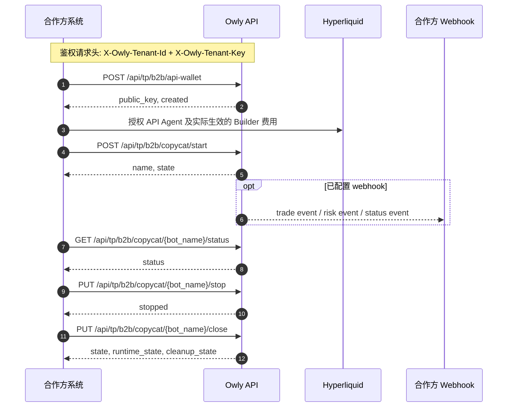

这篇文档面向与 Owly 进行租户级对接的合作方，说明如何为目标地址创建 API Wallet、启动策略实例、接收 webhook 事件，以及通过外部 API 管理策略生命周期。

<Note>
所有 B2B 接口都使用租户级凭证鉴权。如果你要了解普通用户如何开始使用 Owly，请先阅读 [核心概念](/zh/guide/concepts) 和 [快速入门](/zh/guide/quick-start)。
</Note>

## 接入流程

推荐按下面的顺序完成接入：

1. 为目标地址创建或获取 API Wallet。
2. 将返回的 `public_key` 设置为 Hyperliquid API Agent，并完成有效的 Builder 费用授权。
3. 跟单前可调用 `source-check` 预检交易员，再启动 Owly 策略实例。
4. 保存返回的 Bot 标识，后续用于状态查询和生命周期管理。
5. 如果配置了 webhook，接收 Owly 主动推送的事件通知。



## Base URL

| 环境 | URL |
| --- | --- |
| 生产环境 | `https://app.owly.fi` |
| 开发环境 | `https://dev-app.owly.fi` |

## 鉴权方式

每个请求都需要携带以下请求头：

```http
X-Owly-Tenant-Id: <tenant_id>
X-Owly-Tenant-Key: <tenant_key>
Content-Type: application/json
```

| Header | 必填 | 说明 |
| --- | --- | --- |
| `X-Owly-Tenant-Id` | 是 | Owly 分配的租户标识 |
| `X-Owly-Tenant-Key` | 是 | Owly 分配的租户密钥 |
| `Content-Type` | JSON 请求必填 | `application/json`；GET 请求无需请求体 |

## 通用响应格式

成功响应统一采用以下结构：

```json
{
  "code": 0,
  "msg": "success",
  "timestamp": 1763471388,
  "data": {}
}
```

错误响应的 `detail` 可以是字符串、包含 `code` / `message` 等字段的对象，或参数校验错误列表。启动失败还可能在顶层返回 `bot_name`，便于后续查询。不要只按固定英文错误文案判断结果。例如，协议专用账户不能通过普通 B2B 钱包流程添加：

```json
{
  "detail": {
    "code": "leveracc_dedicated_flow_required"
  }
}
```

常见 HTTP 状态码：

| 状态码 | 含义 |
| --- | --- |
| `400` | 请求参数错误 |
| `401` | 租户鉴权失败 |
| `403` | 租户或目标账户当前不可用 |
| `404` | 资源不存在 |
| `409` | 资源状态冲突 |
| `422` | 请求体或字段校验失败 |
| `500` | 服务内部错误或执行失败 |
| `503` | 账户或授权校验等依赖暂不可用 |

## Step 1：创建或获取 API Wallet

### 端点

```http
POST /api/tp/b2b/api-wallet
```

### 请求体

```json
{
  "target": "0x1111111111111111111111111111111111111111"
}
```

| 字段 | 类型 | 必填 | 说明 |
| --- | --- | --- | --- |
| `target` | string | 是 | 将要运行策略的 EVM 地址 |
| `created` | boolean | 否 | 默认 `false`，优先复用已有钱包；`true` 请求生成替换钱包 |
| `idempotency_key` | string | `created=true` 时必填 | 1–128 个字符；同一次换新重试必须使用同一个值 |

### 成功响应示例

```json
{
  "code": 0,
  "msg": "success",
  "timestamp": 1763471388,
  "data": {
    "tenant_id": "tenant-demo",
    "target": "0x1111111111111111111111111111111111111111",
    "public_key": "0xaaaaaaaaaaaaaaaaaaaaaaaaaaaaaaaaaaaaaaaa",
    "created": true
  }
}
```

| 字段 | 类型 | 说明 |
| --- | --- | --- |
| `tenant_id` | string | 当前租户 ID |
| `target` | string | 请求中的目标地址 |
| `public_key` | string | API Wallet 公钥，需要设置为 Hyperliquid API Agent |
| `created` | boolean | `true` 表示本次新创建；`false` 表示返回了已有钱包 |

<Tip>
API Wallet 的私钥由 Owly 安全保管，不会返回给合作方。
</Tip>

目标账户当前必须使用 `unifiedAccount` 或 `dexAbstraction` 模式；无法确认模式时会拒绝继续。此接口不会替目标账户切换模式。

这里还有几个关键行为需要注意：

- 同一租户重复请求同一个 `target` 时，Owly 会尽量返回已有的钱包。
- 如果 `target` 已被其他租户或其他不兼容流程占用，接口会返回 `409`。
- 换新后必须重新授权返回的 `public_key`，再检查策略状态。生成替换钱包本身不会完成 Hyperliquid 授权。
- `created=true` 的同一幂等键重试返回同一次换新的钱包，避免重复生成。响应 `created` 表示此次调用是否创建了钱包，含义与请求参数不同。

换新请求示例：

```json
{
  "target": "0x1111111111111111111111111111111111111111",
  "created": true,
  "idempotency_key": "wallet-rotation-001"
}
```

## Step 2：在 Hyperliquid 设置 API Agent

使用 Step 1 返回的 `public_key`，在 Hyperliquid 中将其设置为目标地址对应的 API Agent。

这些授权由合作方在 Hyperliquid 侧完成。除 API Agent 外，还需授权实际生效的 Builder 地址及费率；启动时会核对 Builder 授权，不能只完成 Agent 授权。Builder 配置可能来自账户、已有策略或租户配置，应按接入约定确认，不能把某个费率写死为所有租户的要求。

## 跟单交易员预检

```http
POST /api/tp/b2b/copycat/source-check
```

使用相同租户请求头，提交 1–20 个 EVM 地址：

```json
{
  "sources": ["0x2222222222222222222222222222222222222222"]
}
```

成功响应的 `data` 示例：

```json
{
  "results": [
    {
      "address": "0x2222222222222222222222222222222222222222",
      "eligible": true,
      "account_mode": "unifiedAccount",
      "rejection_reason": null,
      "order_risk_metrics": null
    }
  ]
}
```

此预检要求交易员使用 `unifiedAccount`，并在启用订单行为风控时检查历史订单。拒绝原因包括 `account_mode_not_unified`、`high_risk_order_behavior` 或校验数据暂不可用；风险指标可能为空。结果不是授权或执行保证，启动时仍会重新校验。

## Step 3：启动策略实例

### 端点

```http
POST /api/tp/b2b/copycat/start
```

### 请求体

```json
{
  "config": {
    "bot_type": "copytrading",
    "target": "0x1111111111111111111111111111111111111111",
    "source": "0x2222222222222222222222222222222222222222",
    "copy_ratio": 1.0,
    "included_coins": [],
    "excluded_coins": [],
    "included_dexs": [""],
    "alerts": {
      "enable": true,
      "webhook": "https://partner.example.com/owly/callback"
    }
  }
}
```

| 字段 | 类型 | 必填 | 说明 |
| --- | --- | --- | --- |
| `config` | object | 是 | `copytrading` 或 `grid` 策略配置；公开接口只支持 Hyperliquid 目标账户 |
| `config.alerts` | object | 否 | 通知设置；示例显式启用通知并指定 webhook |
| `config.alerts.webhook` | string \| null | 否 | 推荐使用的回调地址字段；显式 `null` 清空 |
| `webhook` | string \| null | 否 | 已弃用的顶层兼容字段；迁移到 `config.alerts.webhook` |

普通跟单需要 `source`；`grid` 需要有效的 `grid` 配置。永续网格的 `grid.total_invest` 必填且大于零，服务端据此计算单笔数量，详见[网格机器人](/zh/guide/grid-bot)。不要在请求中提交主钱包或 API 钱包私钥。

### Webhook 优先级

| 传参方式 | 行为 |
| --- | --- |
| 显式设置 `config.alerts.webhook` | 优先于顶层 `webhook` 和租户默认值；显式 `null` 清空 |
| 未设置嵌套字段，但设置顶层 `webhook` | 使用兼容字段；显式 `null` 清空 |
| 两个字段均省略，租户有默认值 | 使用租户默认 webhook |
| 两个字段均省略，租户无默认值 | 保留已有策略的 webhook |

仅设置 `config.alerts=null` 不等于显式设置 `config.alerts.webhook=null`。通知是否发送还取决于通知开关和事件配置。

### 成功响应示例

```json
{
  "code": 0,
  "msg": "success",
  "timestamp": 1763471390,
  "data": {
    "name": "bot_abc123",
    "state": "running",
    "runtime_state": "active",
    "cleanup_state": "none",
    "start_time": null,
    "uptime": null,
    "err_msg": null
  }
}
```

<Note>
响应里的 `name` 就是后续接口里使用的 `bot_name`。请在自己的系统里持久化保存。
</Note>

## Webhook 通知

启用通知并配置有效 webhook 后，Owly 可向合作方的回调地址推送已配置的策略通知。

常见通知类型包括：

- `trade event`：策略实例产生的交易相关事件
- `risk event`：策略实例产生的风控相关事件
- `status event`：策略状态变化事件

对 webhook 接收端的建议：

- 返回 `2xx` 表示接收成功
- 接收逻辑要按幂等方式设计
- 默认认为可能发生重试和重复投递
- 只依赖 Owly 对外约定的事件字段和业务语义，不要依赖内部服务名或内部状态机

## 策略实例管理接口

### 查询状态

```http
GET /api/tp/b2b/copycat/{bot_name}/status
```

状态响应示例：

```json
{
  "code": 0,
  "msg": "success",
  "timestamp": 1763471391,
  "data": {
    "name": "bot_abc123",
    "state": "running",
    "runtime_state": "active",
    "cleanup_state": "none",
    "start_time": null,
    "uptime": null,
    "err_msg": null
  }
}
```

`data` 使用策略状态结构，启动、停止和关闭的成功响应也返回此结构：

| 字段 | 含义 |
| --- | --- |
| `name` | 后续请求使用的 `bot_name` |
| `state` | 生命周期状态，如 `running`、`stopped`、`terminated`、`error` |
| `runtime_state` | 执行状态，如 `active`、`idle`、`degraded`、`risk_exit_in_progress`、`risk_exit_failed` |
| `cleanup_state` | 清理状态：`none`、`in_progress`、`completed` 或 `failed` |
| `start_time` / `uptime` | 启动时间及运行秒数，可能为空 |
| `err_msg` | 可选错误信息 |

应同时核对执行状态、清理状态和错误信息；`state=running` 本身不能说明策略当前正在正常下单。

### 停止策略实例

```http
PUT /api/tp/b2b/copycat/{bot_name}/stop
```

`stop` 停止策略自动执行，不执行平仓清理。已有持仓和订单应单独检查。下面是已停止状态的示例：

```json
{
  "code": 0,
  "msg": "success",
  "timestamp": 1763471392,
  "data": {
    "name": "bot_abc123",
    "state": "stopped",
    "runtime_state": "stopped",
    "cleanup_state": "none",
    "start_time": null,
    "uptime": null,
    "err_msg": null
  }
}
```

### 关闭策略实例

```http
PUT /api/tp/b2b/copycat/{bot_name}/close
```

`close` 请求终止策略并执行相应清理，包含尝试平仓及清理相关订单。它不是提现或偿还借款操作。检查 `cleanup_state` 与 `err_msg`，并核对实际持仓和订单；超时或清理失败时先查询当前状态再决定后续处理。

以下仅展示清理完成时的响应形状，不代表每次请求都能完成清理：

```json
{
  "code": 0,
  "msg": "success",
  "timestamp": 1763471393,
  "data": {
    "name": "bot_abc123",
    "state": "terminated",
    "runtime_state": "terminated",
    "cleanup_state": "completed",
    "start_time": null,
    "uptime": null,
    "err_msg": null
  }
}
```

## 常见错误

| 状态码 | 场景 | 处理方向 |
| --- | --- | --- |
| `400` | 目标账户模式不支持、Agent 或 Builder 授权不完整 | 检查账户模式及实际生效的授权配置 |
| `401` | 租户凭证错误 | 检查两个租户请求头 |
| `403` | 租户停用或账户不可用 | 确认租户和账户状态 |
| `404` | 目标账户或策略不存在 | 检查所属租户与 `bot_name` |
| `409` | 地址归属冲突、生命周期操作并发或状态不兼容 | 先查询状态，再处理冲突 |
| `422` | 地址、幂等键或策略字段无效 | 按当前请求结构修正参数 |
| `500` / `503` | 执行失败或校验依赖暂不可用 | 保留 `bot_name` 和错误详情，查询当前状态 |

错误可能返回结构化业务码或字符串。不要把超时直接视为没有启动；先用已知的 `bot_name` 查询状态，避免重复操作。

## 最小 cURL 示例

### 获取 API Wallet

```bash
curl -X POST "https://dev-app.owly.fi/api/tp/b2b/api-wallet" \
  -H "Content-Type: application/json" \
  -H "X-Owly-Tenant-Id: tenant-demo" \
  -H "X-Owly-Tenant-Key: tenant-secret" \
  -d '{
    "target": "0x1111111111111111111111111111111111111111"
  }'
```

### 启动策略实例

```bash
curl -X POST "https://dev-app.owly.fi/api/tp/b2b/copycat/start" \
  -H "Content-Type: application/json" \
  -H "X-Owly-Tenant-Id: tenant-demo" \
  -H "X-Owly-Tenant-Key: tenant-secret" \
  -d '{
    "config": {
      "bot_type": "copytrading",
      "target": "0x1111111111111111111111111111111111111111",
      "source": "0x2222222222222222222222222222222222222222",
      "copy_ratio": 1.0,
      "included_coins": [],
      "excluded_coins": [],
      "included_dexs": [""],
      "alerts": {
        "enable": true,
        "webhook": "https://partner.example.com/owly/callback"
      }
    }
  }'
```

### 查询状态

```bash
curl -X GET "https://dev-app.owly.fi/api/tp/b2b/copycat/bot_abc123/status" \
  -H "X-Owly-Tenant-Id: tenant-demo" \
  -H "X-Owly-Tenant-Key: tenant-secret"
```

## 接入建议

- 按 `api-wallet -> Hyperliquid Agent + Builder 授权 -> 可选 source-check -> start` 顺序执行。
- 拿到返回的 `bot_name` 后立刻做持久化保存。
- webhook 接收端建议实现幂等和重试保护。
- 把 webhook 事件视为 Owly 的业务通知，不要依赖 Owly 内部实现细节。
- 默认复用 API Wallet；需要换新时显式传 `created=true`，同一次换新重试复用幂等键。
- 如果启动失败，检查租户鉴权、账户模式、Agent 与 Builder 授权、地址归属及策略参数；结合运行和清理状态处理结果。
